# One Gacha API — Lab 12 to Lab 14

**Dr. Pisit Praiwattana, your mentor in 2026**

One Express (Node 24) API with PostgreSQL 18: recharge **virtual coins**, exchange 100 coins for 1 gem, and spend 10 gems on one random draw.
No payment provider, real money or valuable prize is connected. There is no authentication: a student ID only names a practice wallet.

ภาษาไทย: [README.md](README.md)

## Contents

- [Lab 12 · Docker + PostgreSQL in six steps](#lab12)
- [Lab 13 · Before you start: two ideas](#lab13-ideas) — Compose override files, reverse proxy
- [Lab 13 · 01 Run the local overlay](#lab13-01)
- [Lab 13 · 02 Reverse proxy with local NPM](#lab13-02) — [Step 0](#npm-step0) · [Step 1 `localhost`](#npm-step1) · [Step 2 `/backend/`](#npm-step2) · [Step 3 `gacha.test`](#npm-step3) · [Step 3 on a server](#npm-step3-server)
- [Lab 13 · 03 CORS experiment with Docker Compose](#lab13-03)
- [Lab 13 · 04 Ubuntu VM as the server](#lab13-04)
- [Lab 14 · CI/CD in five steps](#lab14) — GitHub Actions, smoke test, GHCR image, Render/Railway deploy after CI, secrets
- [Folder map](#folder-map) · [API contract](#api-contract) · [2% SSR maths](#ssr-odds) · [Command-line exercise](#command-line) · [API specification](#api-spec)
- [Troubleshooting](#troubleshooting) · [Tests and production boundary](#tests) · [References](#references)

How to read the commands:
- Run every command in this folder (`gacha-workshop/` in the download) with Docker Desktop or Docker Engine + Compose. You do not need Node.js or PostgreSQL.
- Windows: PowerShell and `curl.exe`. macOS/Linux: a terminal and `curl`. Replace `6688123` with your own student ID.
- In Lab 13, **NPM means Nginx Proxy Manager**, not Node's `npm`. The Lab 13 submission covers experiments 01–04 only.

<a id="lab12"></a>
## Lab 12 · Docker + PostgreSQL in six steps

**1. Create `.env` and set your student ID.**
```text
# Windows PowerShell
Copy-Item .env.example .env
notepad .env
# macOS / Linux
cp .env.example .env
nano .env
```
Change `STUDENT_ID=6688123` to your ID and save. Keep the same ID for all of Lab 12 and Lab 13: it names the project `gacha-<ID>` and its database volume.

**2. Build and start the stack.** It returns once `db` and `app` are healthy (the first build takes longer).
```text
docker compose up -d --build --wait
```

**3. Check the containers.**
```text
docker compose ps
```
Expected: `app` `Up … (healthy)` `127.0.0.1:8085->3000/tcp`; `db` `Up … (healthy)` `5432/tcp`. `db` has no host address: only containers in this project can reach it.

**4. Use the API in the browser.** Open **http://localhost:8085/test**, type your student ID, then click in this order:

| Button | Expected |
| --- | --- |
| GET · Health + DB | 200, `"database":"connected"` |
| GET · Wallet | 200, your wallet (a new one starts with 0 coins, 0 gems) |
| POST · Recharge (amount 1000) | 201, coins +1000 |
| POST · Exchange (amount 1000) | 201, coins −1000, gems +10 |
| POST · Draw once | 201, gems −10 and a `draw` object |
| GET · Saved history | 200, your draw appears in `draws` |

Write down the draw `id`, `result_name` and `created_at`.

**5. Look inside PostgreSQL.**
```text
docker compose exec db psql -U gacha -d gacha
```
Inside `psql`:
```sql
\dt
SELECT student_id, coins, gems FROM wallets;
SELECT id, student_id, result_name, rarity, created_at FROM draws ORDER BY id;
\q
```
Expected: three tables (`draws`, `transactions`, `wallets`), your wallet row, and the draw you wrote down.

**6. Prove that the data survives `down` and `up`.**
```text
docker compose down
docker compose up -d --wait
```
Open http://localhost:8085/test and click **GET · Saved history** only (do not draw again). Expected: the same draw `id` and `created_at`.

> **Never add `-v` here.** `docker compose down -v` deletes the named volume and every saved draw.

Optional proof: `docker compose ps -q db` before `down` and after `up` shows a new container ID; `docker volume ls` shows `gacha-<ID>_pgdata`.

**What just happened:** plain `docker compose` loaded `compose.yml` **plus** `compose.override.yml` (which only publishes `127.0.0.1:8085`). The app reaches PostgreSQL at `db:5432` through Docker DNS, and the rows live in the named volume `pgdata`, which `down` does not remove.

<a id="lab13-ideas"></a>
## Lab 13 · Before you start: two ideas

### A. One base file + small override files

`compose.yml` holds what is the **same everywhere** and publishes **no ports**. Each overlay adds only what is **different**:

| File | What it adds | Used in |
| --- | --- | --- |
| `compose.yml` | app + db + `pgdata` volume + healthchecks; no ports | always, listed first |
| `compose.override.yml` | app port `127.0.0.1:8085` | Lab 12 (loaded automatically) |
| `compose.local.yml` | the same app port, chosen with `-f` | 01, 03 |
| `compose.staging.yml` | app port `127.0.0.1:8086` + restart policy | preview with `config` only |
| `compose.production.yml` | `restart: unless-stopped`; no ports | 02, 04 |
| `compose.proxy.yml` | `npm` service (Nginx Proxy Manager 2.16.0) on 80, 443 and `127.0.0.1:81` + its volumes | 02, 04 |
| `compose.cors.yml` | `tester` service: the visual tester on `127.0.0.1:5500`, a second origin | 03 |

**Rule:** with `-f`, `compose.override.yml` is **not** loaded. List the base first, then **one** environment overlay (local, staging or production), then optional helpers (proxy, cors). `docker compose config` prints the merged result without starting anything (`...` = `docker compose --env-file .env`):

| Command | app ports | restart | other services |
| --- | --- | --- | --- |
| `docker compose config` | `127.0.0.1:8085→3000` (from the override) | – | – |
| `docker compose -f compose.yml config` | none | – | – |
| `... -f compose.yml -f compose.production.yml -f compose.proxy.yml config` | none | `unless-stopped` | `npm`: 80→80, 443→443, `127.0.0.1:81→81` |
| `... -f compose.yml -f compose.local.yml -f compose.production.yml config` | **`127.0.0.1:8085→3000` still there** | `unless-stopped` | – |
| `... -f compose.yml -f compose.local.yml -f compose.cors.yml config --services` | services: `db`, `app`, `tester` | | |

Row 4 is the **pitfall**: a later file that says nothing about ports keeps the earlier published port, so never chain two environment overlays.
**Why:** one source of truth instead of drifting copies, no app or database ports in production, the same image everywhere, and `config` shows what will run before you start it.

### B. Why production uses a reverse proxy, and how it works

A reverse proxy is the **one public entry** (ports 80/443) in front of your apps. It keeps the app and database private, routes by host name and path, holds the HTTPS certificates, and can serve a page and its API under **one origin**, so no CORS is needed (see [03](#lab13-03)).

How one request for `http://gacha.test/backend/test` travels:

1. **Name → IP.** The hosts file (laptop) or DNS (server) turns `gacha.test` into an IP.
2. **Connect.** The browser sends `GET /backend/test` with `Host: gacha.test` to the proxy on port 80.
3. **Pick the site** whose `server_name` matches the Host header. No match → NPM's default 404 page.
4. **Pick the location** that matches the path: `/backend/`.
5. **Rewrite and forward.** `/backend/test` becomes `/test` and goes to `app:3000` (Docker DNS), with `X-Forwarded-*` headers.
6. **Relay** the app's response back to the browser.
```text
Browser ──GET /backend/test, Host: gacha.test──▶ NPM :80 ──GET /test──▶ app:3000 ──▶ db:5432
```
In plain Nginx, steps 4–5 are one block; NPM writes the equivalent from the form in 02:
```nginx
location /backend/ {
    proxy_pass http://app:3000/;   # the trailing / replaces the /backend/ prefix with /
    proxy_set_header Host $host;
    proxy_set_header X-Forwarded-For $proxy_add_x_forwarded_for;
    proxy_set_header X-Forwarded-Proto $scheme;
}
```
NPM is a classroom GUI; for real production prefer reviewed Nginx configuration. It adds no authentication, rate limits or backups to your app.

<a id="lab13-01"></a>
## Lab 13 · 01 Run the local overlay

From now on every command lists its files with `-f`.

**1. Open the right folder and check `.env`.** Work in the folder with `compose.yml`; for 03 it must also contain `compose.cors.yml` (otherwise extract the Lab 13 download and work there).
- Lab 12 folder: **keep** its `.env` (do not copy `.env.example` over it) and check that `STUDENT_ID` is yours.
- Fresh folder: copy your Lab 12 `.env` into it, or create one as in [Lab 12 step 1](#lab12) with the same `STUDENT_ID`.

**2. Stop the Lab 12 stack (the data stays).** Run it in the Lab 12 folder, or here once `.env` exists:
```text
docker compose down
```

**3. Check the merged configuration.** Expected: no output (= valid).
```text
docker compose --env-file .env -f compose.yml -f compose.local.yml config --quiet
```

**4. Start the stack and check it.**
```text
docker compose --env-file .env -f compose.yml -f compose.local.yml up -d --build --wait
docker compose --env-file .env -f compose.yml -f compose.local.yml ps
```
Expected: `app` → `127.0.0.1:8085->3000/tcp`; `db` → `5432/tcp` (no host port).

**5. Record a draw.** Open **http://localhost:8085/test** → Health → Wallet → Recharge 1000 → Exchange 1000 → Draw once → Saved history.
Write down the new draw `id` and `created_at`. With the same `STUDENT_ID` on the same computer, your Lab 12 draw is still listed (same `pgdata` volume).

**6. Optional: check the rows in PostgreSQL.**
```text
docker compose --env-file .env -f compose.yml -f compose.local.yml exec db psql -U gacha -d gacha -c "SELECT id, result_name, created_at FROM draws ORDER BY id;"
```

**7. See the merge at work.** Compare the `ports:` of `app` with the table in [A](#lab13-ideas):
```text
docker compose --env-file .env -f compose.yml config
docker compose --env-file .env -f compose.yml -f compose.local.yml config
docker compose --env-file .env -f compose.yml -f compose.local.yml -f compose.production.yml config
```
Expected: no `ports:` under `app` in the first; `host_ip: 127.0.0.1`, `published: "8085"` in the second; the third (the pitfall) still has this port plus `restart: unless-stopped`.

Record for the report: a `config` excerpt (hide `PGPASSWORD` and `POSTGRES_PASSWORD`), the `ps` output, and the draw `id` + `created_at`.

<a id="lab13-02"></a>
## Lab 13 · 02 Reverse proxy with local NPM (step by step)

Goal: `http://gacha.test/backend/test` → NPM → `app:3000`, with no app port on your computer. Test after each step.

<a id="npm-step0"></a>
### Step 0 — Start production + proxy and create the NPM admin

1. Stop the local stack (the data stays):
   ```text
   docker compose --env-file .env -f compose.yml -f compose.local.yml down
   ```
2. Start base + production + proxy and check the ports:
   ```text
   docker compose --env-file .env -f compose.yml -f compose.production.yml -f compose.proxy.yml up -d --build --wait
   docker compose --env-file .env -f compose.yml -f compose.production.yml -f compose.proxy.yml ps
   ```
   Expected: `app` `3000/tcp`, `db` `5432/tcp`, `npm` `0.0.0.0:80->80/tcp, 0.0.0.0:443->443/tcp, 127.0.0.1:81->81/tcp` (Docker may add `[::]:…` IPv6 entries).
   Only NPM has host ports, so `http://localhost:8085` no longer answers. Port 80 or 443 already allocated → see [Troubleshooting](#troubleshooting).
3. Open **http://localhost/**. Expected: NPM's default "Congratulations" page (no proxy host yet).
4. Open **http://127.0.0.1:81**, fill in **Full Name**, **Email address** and **New Password**, then **Save**. NPM 2.16 has no default `admin@example.com` / `changeme` login.

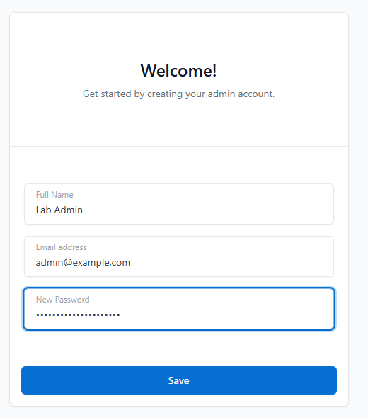\
*First visit to http://127.0.0.1:81: create the admin account.*

<a id="npm-step1"></a>
### Step 1 — Proxy Host `localhost` → `http://app:3000`

1. Click **Hosts → Proxy Hosts → Add Proxy Host**.
2. On the **Details** tab fill in: **Domain Names** `localhost` (type it, then press **Enter** so it becomes a chip) · **Scheme** `http` · **Forward Hostname / IP** `app` · **Forward Port** `3000`. Leave Access List and Options as they are (Publicly Accessible, all switches off).
3. Click **Save**. Expected: "Proxy Host has been saved" and one row: `localhost` → `http://app:3000`, HTTP Only, Public, Online.

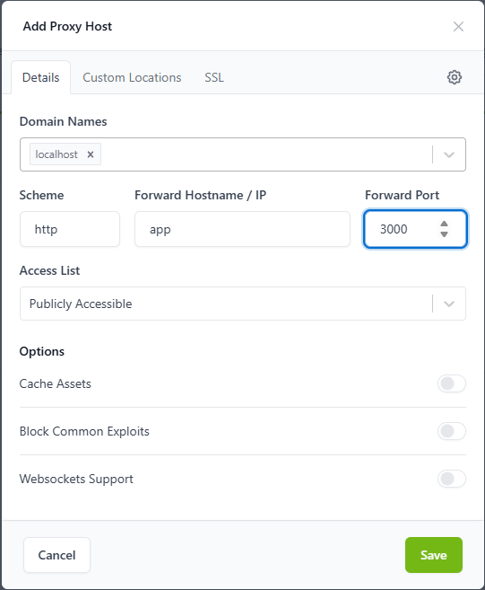\
*Details tab: `localhost` → `http` · `app` · `3000`.*

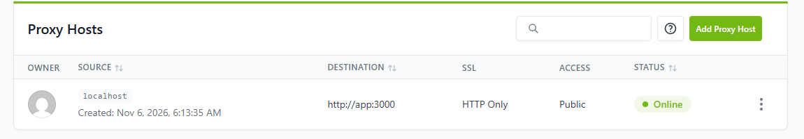\
*After Save: the proxy host is Online.*

**Test these URLs:**

| URL | Expected |
| --- | --- |
| http://localhost/health | 200 `{"status":"ok","database":"connected","app":"gacha"}` |
| http://localhost/test | the tester; **GET · Health + DB** shows `GET http://localhost/health` HTTP 200 OK |
| http://localhost/api/catalog | 200 JSON (rules and results) |
| http://localhost/visual/ | 200, the visual tester |
| http://localhost/api/accounts/6688123/history | 200; your draws from 01 are still there (same volume) |

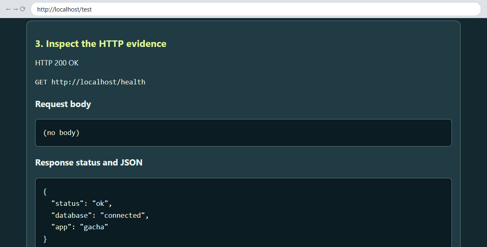\
*http://localhost/test through NPM on port 80.*

**Why `app`?** It is the service name, resolved by Docker DNS on the network `npm` and `app` share. Inside NPM, `localhost` is never your app.

> **Optional — try a wrong upstream once (not for the report).** **⋮ → Edit**, change Forward Hostname / IP, **Save**, reload http://localhost/health:
>
> | Forward Hostname / IP | Browser result | Why |
> | --- | --- | --- |
> | `localhost` | **502 Bad Gateway** (openresty) | NPM cannot resolve the name; the log says `localhost could not be resolved (3: Host not found)` |
> | `127.0.0.1` | **404** `{"error":{"code":404,"message":"Not Found - /health"}}` | NPM's own admin API, on port 3000 inside the NPM container |
> | `app` | 200 from the gacha app | Docker DNS finds the app container |
>
> NPM shows **Online** in all three cases (the config loaded, not the upstream works). Read the real error:
> ```text
> docker compose --env-file .env -f compose.yml -f compose.production.yml -f compose.proxy.yml exec npm sh -c 'tail -n 5 /data/logs/proxy-host-*_error.log'
> ```
>
> 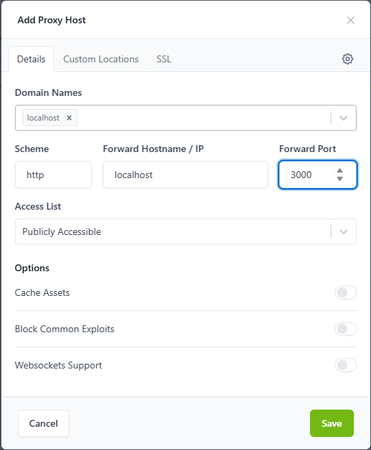\
> *Wrong upstream `localhost` → 502.*
>
> **Before Step 2:** set it back to `app`, **Save**, and check that http://localhost/health returns 200.

<a id="npm-step2"></a>
### Step 2 — Custom Location `/backend/`

Goal: the app also answers under `http://localhost/backend/...` and still receives `/test`, not `/backend/test`.

1. In **Proxy Hosts**, click **⋮** on the `localhost` row → **Edit**.
2. Open **Custom Locations** → **Add Location**.
3. Fill in: Location `/backend/` (slash at both ends), Scheme `http`, Forward Hostname / IP `app`, Forward Port `3000`.
4. Click the **gear** right beside the Location field (not the host-level gear at the top-right) and type **only**:
   ```nginx
   rewrite ^/backend/(.*)$ /$1 break;
   ```
5. Click **Save**.

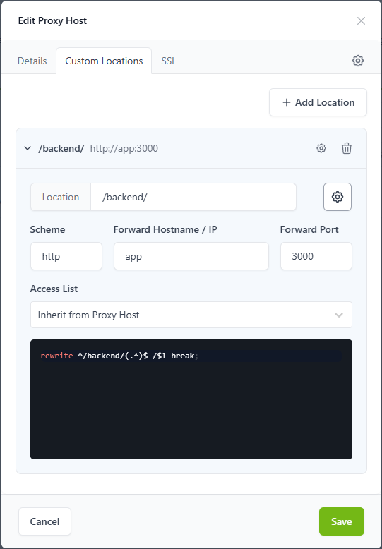\
*Custom Location `/backend/` → `http://app:3000` with the rewrite line.*

Do not paste a `location { ... }` block or `proxy_pass` into the gear editor; NPM generates those. To read the generated file:
```text
docker compose --env-file .env -f compose.yml -f compose.production.yml -f compose.proxy.yml exec npm sh -c 'cat /data/nginx/proxy_host/*.conf'
```

**Test these URLs:**

| URL | Expected | Why |
| --- | --- | --- |
| http://localhost/backend/test | 200 tester; its buttons call `http://localhost/backend/api/...` (Recharge → 201) | the rewrite sends `/test` to the app |
| http://localhost/backend/health | 200 health JSON | the app receives `/health` |
| http://localhost/backend/api/catalog | 200 | |
| http://localhost/backend/visual/ | 200 | |
| http://localhost/backend | **301** → `http://localhost/backend/` | Nginx adds the slash for a `/backend/` location |
| http://localhost/backend/ | 200 `{"app":"Gacha Workshop","test":"./test","visual":"./visual/","currency":"virtual demo only"}` | the app receives `/` |
| http://localhost/backendX | 404 `{"error":"Route not found."}` | not under `/backend/`, so `location /` sends `/backendX` to the app |
| http://localhost/test | still 200 | the root location still forwards everything |

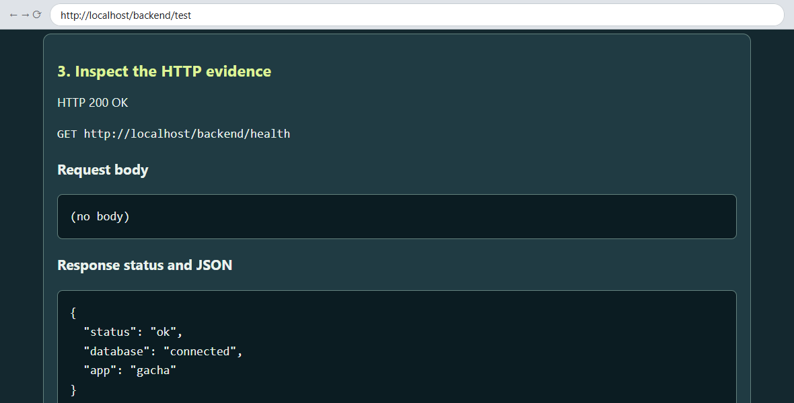\
*The tester keeps the `/backend` prefix for every button.*

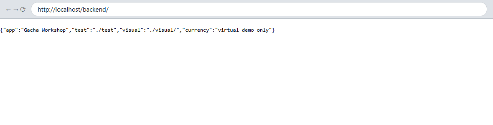\
*`/backend` → 301 → `/backend/` (the app root JSON).*

**`/backend/` vs `/backend`: what changes**

| Location | Forward Hostname | Gear editor | `/backend/test` | `/backend` | `/backendX`, `/backend-admin` |
| --- | --- | --- | --- | --- | --- |
| `/backend/` ✓ | `app` | rewrite | 200 | 301 → `/backend/` | not captured (go to `location /`) |
| `/backend` (no slash) | `app` | rewrite | 200 | **404** Route not found (the app received `/backend`; no redirect) | **captured** by this location, sent unchanged → 404 |
| `/backend/` | `app` | (empty) | **404** Route not found (the app received `/backend/test`) | 301 | – |
| `/backend/` | `app/` | (empty) | 200 (NPM writes `proxy_pass http://app:3000/;`) | 301 | – |

Use row 1. Row 4 is a valid alternative: the path in `app/` makes NPM write `proxy_pass http://app:3000/;`, the trailing-slash rule from [B](#lab13-ideas).

<a id="npm-step3"></a>
### Step 3 (local) — Your own name `gacha.test`

1. **Point the name at your computer.** Add this line to the hosts file:
   ```text
   127.0.0.1 gacha.test
   ```
   - Windows: Start → type **Notepad** → right-click → **Run as administrator** → File → Open `C:\Windows\System32\drivers\etc\hosts` (show "All files") → add the line at the end → Save.
   - macOS/Linux: `sudo nano /etc/hosts` → add the line at the end → Ctrl+O, Enter, Ctrl+X.
2. **Test the name before NPM knows it:**
   ```text
   curl.exe -i http://gacha.test/backend/test
   ```
   Expected: `HTTP/1.1 404 Not Found`, `Server: openresty` and `<center><h1>404 Not Found</h1></center>`. No proxy host lists `gacha.test`, so NPM's default server answered: the **Host header** decides.
3. **Add the name in NPM:** **⋮ → Edit** → **Details** → Domain Names: type `gacha.test` and press **Enter** (two chips: `localhost`, `gacha.test`) → **Save**.
4. **Test these URLs.** Type the full `http://`, or the browser may search for the words.

   | URL | Expected |
   | --- | --- |
   | http://gacha.test/backend/health | 200 |
   | http://gacha.test/backend/test | 200; Health → `GET http://gacha.test/backend/health` HTTP 200 OK |
   | http://gacha.test/backend | 301 → `/backend/` |
   | http://gacha.test/test | 200 |

5. **Confirm where the name went:** `curl.exe -v http://gacha.test/backend/health` shows `Trying 127.0.0.1:80`.

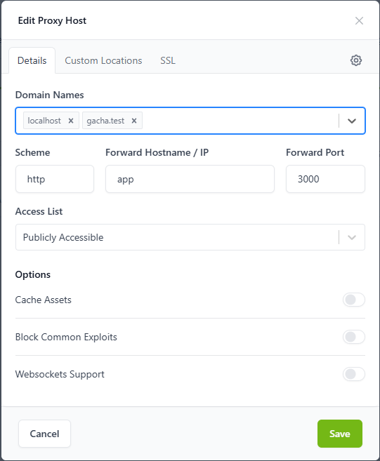\
*One proxy host, two names.*

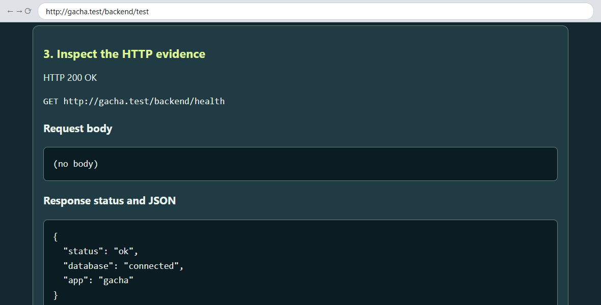\
*hosts file → NPM :80 → Host `gacha.test` → `/backend/` → `app:3000`.*

`.test` is reserved for testing (RFC 2606); no public certificate can be issued for it.

<a id="npm-step3-server"></a>
### Step 3 (on a server) — what changes

| | Your laptop (this lab) | Ubuntu VM in class (04) | Public VPS with a real domain |
| --- | --- | --- | --- |
| Who resolves the name | laptop hosts file: `127.0.0.1 gacha.test` | the **laptop** hosts file: `192.168.1.50 gacha.test` (the VM IP); nothing changes on the VM | a DNS A/AAAA record → the server's public IP; no hosts file |
| NPM admin | http://127.0.0.1:81 | SSH tunnel `ssh -L 8181:127.0.0.1:81 student@192.168.1.50`, then http://localhost:8181 | the same SSH tunnel |
| HTTPS | none (`.test` cannot get a public certificate) | none in class | SSL tab → **Request a new Certificate** (Let's Encrypt) + **Force SSL**; the domain must already resolve to the server and port 80 must reach NPM |
| Open ports | nothing to open | classroom LAN only | 80 and 443 (plus SSH) only; never publish 3000, 5432 or 81 |
| Test URL | http://gacha.test/backend/test | http://gacha.test/backend/test | https://your-domain/backend/test |
| CORS | a page on another origin must be listed, e.g. `http://localhost:5500` | the same | a page on another origin must be listed with its exact `https://` origin |

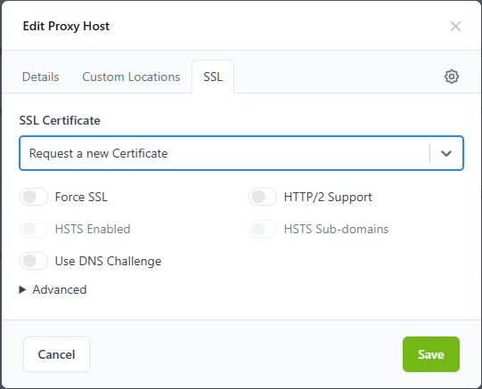\
*SSL tab, real server only. Do not save this for `gacha.test`.*

Record for the report: four screenshots of your own NPM (Step 1 form, Proxy Hosts list (Online), Step 2 Custom Location, Step 3 Domain Names); browser results for http://localhost/test, http://localhost/backend/test and http://gacha.test/backend/test; a table of the `/backend` vs `/backend/` results you observed; a request-path diagram; and your 01 draw still readable.

<a id="lab13-03"></a>
## Lab 13 · 03 CORS experiment with Docker Compose

An **origin** is scheme + host + port (`http://localhost:5500` ≠ `http://localhost:8085`). The **browser** enforces CORS and the API allows a page by sending `Access-Control-Allow-Origin`; `curl` and Postman are never blocked.

### Step 0 — Start local + cors

1. Stop the 02 stack (the data and NPM settings stay):
   ```text
   docker compose --env-file .env -f compose.yml -f compose.production.yml -f compose.proxy.yml down
   ```
2. In `.env` (`notepad .env` / `nano .env`), make sure the line reads `CORS_ORIGINS=` with nothing after it (add it if missing).
3. Free port 5500: stop VS Code Live Server ("Port : 5500" in the status bar) and any `npm start` or `python -m http.server` in `visual-tester/`.
4. Start base + local + cors. The `tester` service serves the visual tester from a **second origin**, `http://localhost:5500`:
   ```text
   docker compose --env-file .env -f compose.yml -f compose.local.yml -f compose.cors.yml up -d --build --wait
   docker compose --env-file .env -f compose.yml -f compose.local.yml -f compose.cors.yml ps
   ```
   Expected: `app` `127.0.0.1:8085->3000/tcp` (healthy), `db` `5432/tcp` (healthy), `tester` `127.0.0.1:5500->5500/tcp`.
5. Read the app log:
   ```text
   docker compose --env-file .env -f compose.yml -f compose.local.yml -f compose.cors.yml logs app
   ```
   Expected line: `CORS_ORIGINS = (empty: only same-origin pages such as /test and /visual/)`

### Step 1 — Same origin first (no CORS needed)

Open **http://localhost:8085/visual/** → **Connect · GET /health + /api/catalog**.
Expected: "Same origin: this page and the API share http://localhost:8085. No CORS setting is needed." and health 200. (The **ไทย** button shows the tester messages in Thai.)

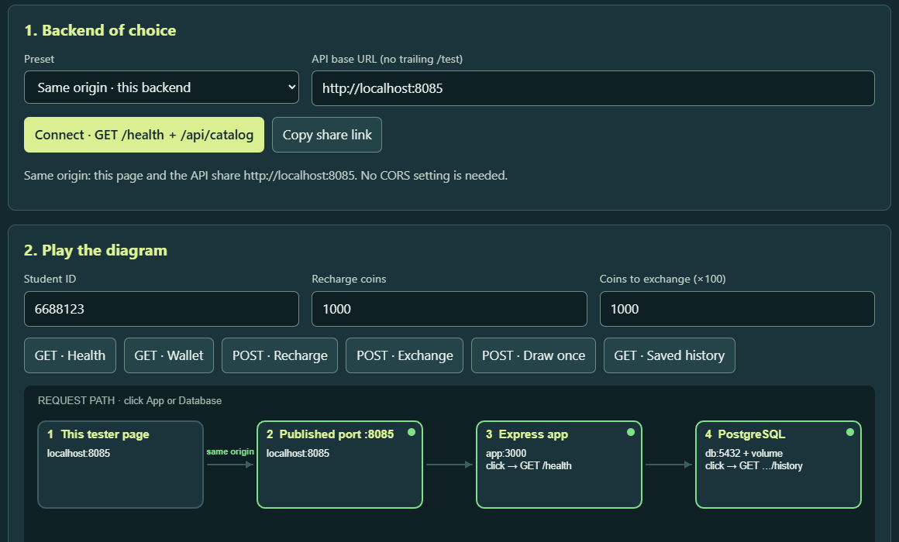\
*The app serves the page itself: one origin.*

### Step 2 — A second origin is blocked

1. Open **http://localhost:5500** → preset **Local direct port · localhost:8085** → **Connect**.
   Expected: a red ✕ **CORS** at the page node; the note says to put `CORS_ORIGINS=http://localhost:5500` in `.env`.
2. **F12** (macOS: Cmd+Option+I) → **Console**. Expected: `Access to fetch at 'http://localhost:8085/health' from origin 'http://localhost:5500' has been blocked by CORS policy: No 'Access-Control-Allow-Origin' header is present on the requested resource.`
3. Prove that the server **did** answer:
   ```text
   curl.exe -i -H "Origin: http://localhost:5500" http://localhost:8085/health
   ```
   Expected: `HTTP/1.1 200 OK` and `{"status":"ok","database":"connected","app":"gacha"}`, but **no** `Access-Control-Allow-Origin` line.
4. Run the `logs app` command from Step 0 again. Expected: `CORS: page origin http://localhost:5500 is not in CORS_ORIGINS (empty). The browser will hide responses from that page.`

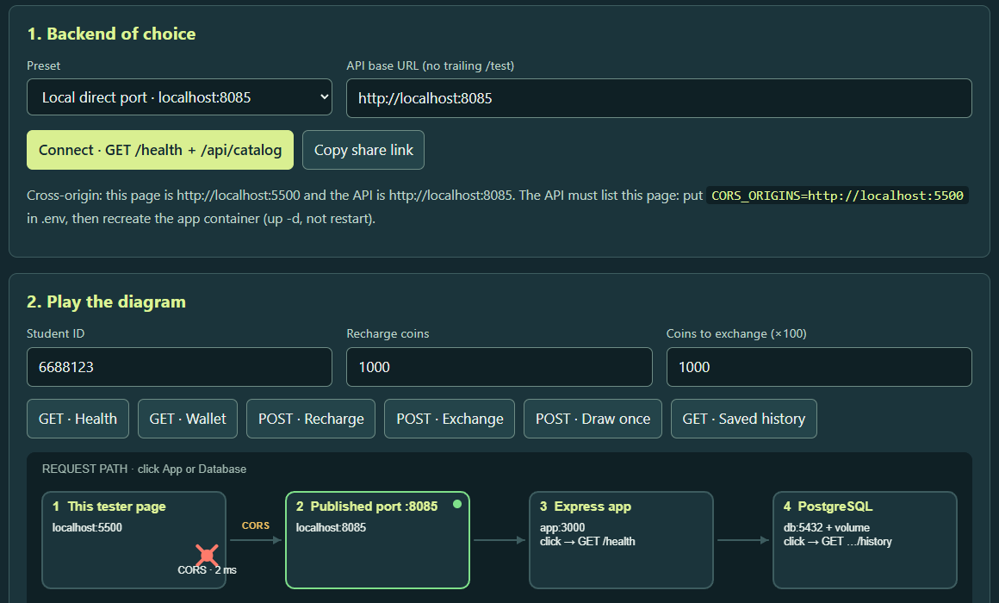\
*`CORS_ORIGINS` empty: the browser hides the answer.*

### Step 3 — Edit `.env`, then `restart` (it does not help)

1. In `.env`, set `CORS_ORIGINS=http://localhost:5500` and save.
2. Restart the app and look inside the container:
   ```text
   docker compose --env-file .env -f compose.yml -f compose.local.yml -f compose.cors.yml restart app
   docker compose --env-file .env -f compose.yml -f compose.local.yml -f compose.cors.yml exec app printenv CORS_ORIGINS
   ```
   Expected: an **empty line**; the curl from Step 2 and the tester are still blocked.

Why: `restart` reuses the existing container, whose environment was fixed when it was created. `up -d` recreates it.

### Step 4 — `up -d` recreates the container (fixed)

1. Recreate the app and look inside again:
   ```text
   docker compose --env-file .env -f compose.yml -f compose.local.yml -f compose.cors.yml up -d --wait app
   docker compose --env-file .env -f compose.yml -f compose.local.yml -f compose.cors.yml exec app printenv CORS_ORIGINS
   ```
   Expected: `http://localhost:5500`. The `logs app` command now ends with `CORS_ORIGINS = http://localhost:5500`.
2. Repeat the curl from Step 2. Expected: `HTTP/1.1 200 OK` with `Vary: Origin` and `Access-Control-Allow-Origin: http://localhost:5500`.
3. In the tester at http://localhost:5500, type **your** student ID → **Connect** → **POST · Recharge**, **POST · Exchange**, **POST · Draw once**, **GET · Saved history**.
   Expected: "Cross-origin and allowed ✓"; health 200, recharge 201, exchange 201, draw 201, history 200.
4. Check the `OPTIONS` **preflight** the browser sends before each JSON `POST`:
   ```text
   curl.exe -i -X OPTIONS http://localhost:8085/api/draw -H "Origin: http://localhost:5500" -H "Access-Control-Request-Method: POST" -H "Access-Control-Request-Headers: content-type"
   ```
   Expected:
   ```text
   HTTP/1.1 204 No Content
   Vary: Origin
   Access-Control-Allow-Origin: http://localhost:5500
   Access-Control-Allow-Methods: GET, POST, OPTIONS
   Access-Control-Allow-Headers: Content-Type
   Access-Control-Max-Age: 600
   ```

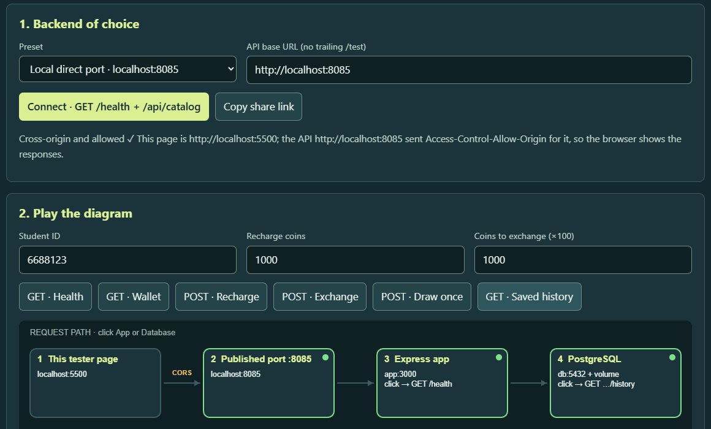\
*After `up -d`: every node green.*

### Step 5 — The exact-origin trap

1. Open **http://127.0.0.1:5500** → **Connect**. Expected: CORS ✕ and "Careful: http://127.0.0.1:5500 and http://localhost:5500 are different origins. List exactly the origin in your address bar."
2. The Console names `origin 'http://127.0.0.1:5500'`; the app log says `CORS: page origin http://127.0.0.1:5500 is not in CORS_ORIGINS (http://localhost:5500). The browser will hide responses from that page.`
3. Fix: open the listed origin (`http://localhost:5500`), **or** list both in `.env` (comma, no path, no trailing slash): `CORS_ORIGINS=http://localhost:5500,http://127.0.0.1:5500`. Then recreate the app:
   ```text
   docker compose --env-file .env -f compose.yml -f compose.local.yml -f compose.cors.yml up -d --wait app
   ```

VS Code Live Server opens `http://127.0.0.1:5500` and Python's `http.server` prints `http://0.0.0.0:5500`: both differ from `http://localhost:5500`.

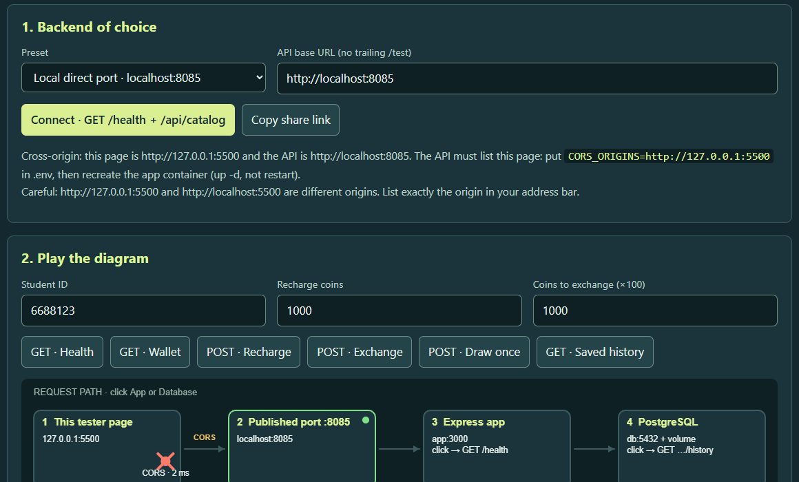\
*Same computer, different origin.*

### Step 6 (optional) — Same origin through the proxy

1. Switch to production + proxy + cors (the data and NPM proxy hosts stay):
   ```text
   docker compose --env-file .env -f compose.yml -f compose.local.yml -f compose.cors.yml down
   docker compose --env-file .env -f compose.yml -f compose.production.yml -f compose.proxy.yml -f compose.cors.yml up -d --build --wait
   ```
2. Open **http://gacha.test/backend/visual/**, type your student ID → **Connect**.
   Expected: "Same origin: this page and the API share http://gacha.test. No CORS setting is needed." Recharge, Exchange and Draw once return 201.
3. Open **http://localhost:5500/?api=http://gacha.test/backend** → **Connect**. This is cross-origin again; it works only because `CORS_ORIGINS` lists `http://localhost:5500`.

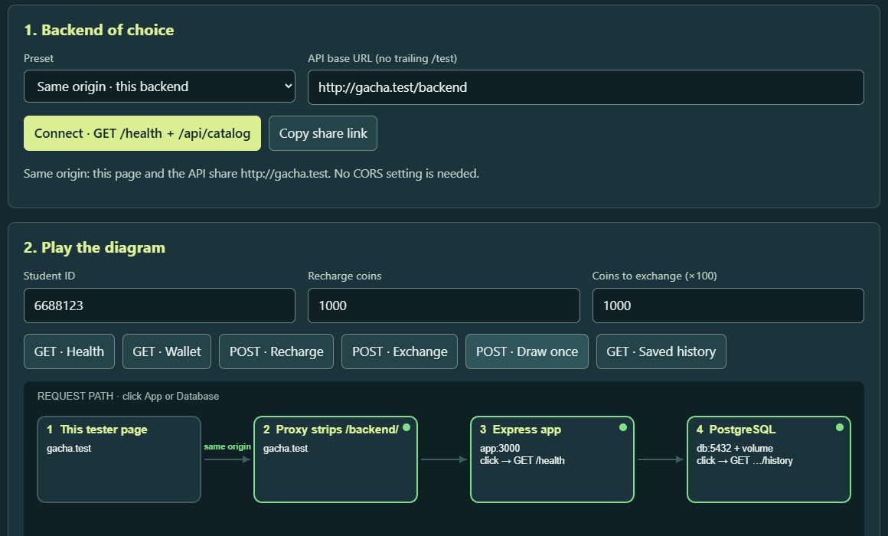\
*Page and API both through NPM at `http://gacha.test`.*

**Lesson:** a reverse proxy that serves the page **and** the API under one origin removes the need for CORS.

When you finish, stop what is running (no `-v`):
```text
# after Step 6
docker compose --env-file .env -f compose.yml -f compose.production.yml -f compose.proxy.yml -f compose.cors.yml down
# if you skipped Step 6
docker compose --env-file .env -f compose.yml -f compose.local.yml -f compose.cors.yml down
```

### CORS checklist

| Symptom | Check | Fix |
| --- | --- | --- |
| The tester shows CORS ✕, but `curl` returns 200 | Is the page origin (from the address bar) in `CORS_ORIGINS`? | Add the exact origin, then `up -d --wait app` |
| Still ✕ after editing `.env` | `exec app printenv CORS_ORIGINS` prints an empty or old value | You used `restart`; run `up -d --wait app` |
| Works on `localhost:5500`, fails on `127.0.0.1:5500` | Compare the address bar with `CORS_ORIGINS` | Open the listed origin, or list both |
| A listed origin is still blocked | Did you add a path, e.g. `http://localhost:5500/index.html`? | An origin has no path. (This app ignores one trailing `/`.) |
| An `https://` page calls an `http://` API | The tester says "Blocked as mixed content" | Use the HTTPS API URL, or run the tester locally over `http` |
| The hosted visual tester on the Lab 13 site fails | It is an `https://` page | It works only with an HTTPS backend whose `CORS_ORIGINS` also lists `https://pisit-devop.com`. For Lab 13 use the app's own `/visual/` (same origin) or the `compose.cors.yml` tester at `http://localhost:5500` |
| The page was opened as `file://` | The tester says the origin is "null" | Serve it over http, e.g. with the `tester` service from `compose.cors.yml` |
| You set `CORS_ORIGINS=*` | Every origin is allowed | Acceptable only for this authless classroom API; list exact origins otherwise |

Record for the report: the blocked screenshot + curl without `Access-Control-Allow-Origin` + the app log line; `printenv` after `restart` (empty) vs after `up -d`; the allowed screenshot + the preflight 204; the `127.0.0.1` trap; and one sentence on why the proxy same-origin page needs no CORS.

<a id="lab13-04"></a>
## Lab 13 · 04 Ubuntu VM as the server

The same files on a different Docker host (details on the Lab 13 site). Replace `192.168.1.50` and `student` with your VM's address and user name.

1. **Reach the VM.** In the VM, `ip -br address` shows its IP. From the laptop: `ssh student@192.168.1.50`.
2. **Check Docker Engine** in the VM (if missing, install it from Docker's official apt repository). Both Client and Server must answer:
   ```bash
   sudo docker version
   sudo docker compose version
   ```
3. **Copy the source, not the data.** VM: `mkdir -p ~/apps`. Laptop: `scp gacha-workshop.zip student@192.168.1.50:~/apps/`. Then in the VM create a **new** `.env` (your student ID, a new password); the VM database starts empty:
   ```bash
   sudo apt install unzip
   cd ~/apps && unzip gacha-workshop.zip && cd gacha-workshop
   cp .env.example .env
   nano .env
   ```
4. **Start production + proxy** in the VM. Expected: the same ports as in [02 Step 0](#npm-step0).
   ```bash
   sudo docker compose --env-file .env -f compose.yml -f compose.production.yml -f compose.proxy.yml up -d --build --wait
   sudo docker compose --env-file .env -f compose.yml -f compose.production.yml -f compose.proxy.yml ps
   ```
5. **Open NPM through an SSH tunnel.** On the laptop, keep `ssh -L 8181:127.0.0.1:81 student@192.168.1.50` open, then create the admin at http://localhost:8181. Port 81 is never published.
6. **Repeat [02 Steps 1–3](#npm-step1) in the VM's NPM:** Domain Names `localhost` and `gacha.test` → `http` · `app` · `3000`, plus the Custom Location `/backend/` with the rewrite line.
7. **Point the laptop at the VM.** With bridged networking, change the laptop hosts line to `192.168.1.50 gacha.test` (see [Step 3 on a server](#npm-step3-server)). With NAT, use your hypervisor's port forwarding.
8. **Test** http://gacha.test/backend/test: Health → Wallet → Recharge → Exchange → Draw once → Saved history. Write down the draw `id` and `created_at`.
9. **Prove persistence on the VM** (no `-v`): record the app container ID, replace the container, show the new ID:
   ```bash
   sudo docker compose --env-file .env -f compose.yml -f compose.production.yml -f compose.proxy.yml ps -q app
   sudo docker compose --env-file .env -f compose.yml -f compose.production.yml -f compose.proxy.yml up -d --force-recreate --wait app
   sudo docker compose --env-file .env -f compose.yml -f compose.production.yml -f compose.proxy.yml ps -q app
   ```
   Expected: a different container ID, and **GET · Saved history** still shows the same draw.
10. **Public VPS only:** `sudo ufw allow OpenSSH`, `sudo ufw allow 80/tcp`, `sudo ufw allow 443/tcp`, then `sudo ufw enable`. Docker-published ports can bypass UFW, so keep 3000, 5432 and 81 unpublished.

<a id="lab14"></a>
## Lab 14 · CI/CD in five steps

Full lesson, slides and report: [Lab 14 site](https://pisit-devop.com/itcs258/Lab14/).  
This folder becomes the **root** of your own GitHub repository.  
Use the copy from the Lab 14 site: a Lab 13 copy has no `.github/workflows/`.

Words, one line each:
- **Commit** = a saved snapshot of your files.
- **SHA** = the ID of a commit; the first 7 characters are enough.
- **Branch** = a separate line of work.
- **Pull request** = a request to merge a branch into `main`.
- **CI** = every push to `main` and every pull request is tested automatically.
- **CD** = only tested code is deployed.
- **Job** = one part of a workflow.
- **Runner** = the temporary machine that runs a job.
- **Check** = the ✓ / ✕ on a commit or pull request.
- **Secret** = a value that gives access.

```text
git push → GitHub Actions: test → integration → publish → ✓ checks → Render / Railway deploys → tester shows the new version
```

**Step 0 · Your own repository.**
1. Create `.env` as in [Lab 12 step 1](#lab12).
2. On GitHub: **+** → **New repository** → a name → **Create repository**. Keep it empty. Public is best.
3. First time using Git on this laptop? Run `git config --global user.name "Your Name"` and `git config --global user.email "you@example.com"`.
4. In this folder (the one where you can see `compose.yml`):
```text
git init
git add .
git commit -m "gacha workshop"
git branch -M main
git remote add origin https://github.com/YOUR-USER/YOUR-REPO.git
git push -u origin main
git ls-files .env
```
Expected: the last command prints nothing.  
`.gitignore` keeps `.env` (your password) out of Git.  
The first push asks you to sign in to GitHub. Asked for a password? Use a personal access token (classic: tick **repo** and **workflow**).

**01 · CI on every push to `main` and every pull request.**
- **Actions** tab → workflow **"CI/CD"** → `test` ✓ → `integration` ✓ → `publish` ✓.
- `publish` runs on `main` only.
- The `test` log shows 11 passing tests and, from `test/check-compose.js`:
```text
PASS  production app publishes no host port
PASS  production db publishes no host port
```

**02 · Break it, then fix it.**
1. `git switch -c break-a-test`
2. In `test/domain.test.js` change `size, 5)` to `size, 6)`.
3. `git commit -am "break a test on purpose"`, then `git push -u origin break-a-test`.
4. On GitHub: **Compare & pull request** → **Create pull request**.
5. Expected: a red ✕ on **"CI/CD / test (pull_request)"**.
6. Change it back, commit and push. Expected: green ✓.
7. **Merge pull request** → **Confirm merge**. `main` runs the full pipeline, including `publish`.
8. On your laptop: `git switch main`, then `git pull`.
9. Optional: **Settings → Rules → Rulesets** → **"Require status checks to pass before merging"** (a public repository on a free account).

The `integration` job starts the real app + PostgreSQL on the runner.  
It runs the smoke test, then `down -v`.  
Its **"Smoke test"** step prints this (CI sets `SMOKE_ORIGIN` and `CORS_ORIGINS`, so the CORS line appears):
```text
Smoke test http://localhost:8085  student smoke-mw4o3ftv
PASS  GET /health → 200 and database connected  (version dev)
PASS  POST /api/recharge 1000 → 201  (coins 1000)
PASS  POST /api/exchange 1000 → 201 and 10 gems
PASS  POST /api/draw → 201 with a saved draw  (Wind Fox)
PASS  POST /api/draw without gems → 409
PASS  GET history shows the draw
PASS  CORS preflight from http://localhost:5500 → 204
All smoke checks passed
```
On your laptop, `npm run smoke -- http://localhost:8085` prints the first 6 `PASS` lines.  
The CORS line appears only when `SMOKE_ORIGIN` and `CORS_ORIGINS` are both `http://localhost:5500`.

**03 · The tested image.**
- Repository page → **Packages** → tag `main`, and one `<short sha>` tag for each push to `main`.
- A new package is private.
- Make it public: **Package settings → Change visibility → Public** (it cannot be made private again).
- Or keep it private and run `docker login ghcr.io` first.
- Use lowercase names:
```text
docker pull ghcr.io/YOUR-USER/YOUR-REPO:main
docker run --rm ghcr.io/YOUR-USER/YOUR-REPO:main node -e "console.log(process.env.GIT_SHA)"
```
Expected: the full commit SHA.  
`publish` logs in with `GITHUB_TOKEN`. You created no secret for it.

**04 · Deploy, gated by CI.**
- Render (main path):
  1. **New → Postgres** (Free) → copy the **Internal Database URL**.
  2. **New → Web Service** → this repository. Not listed? Connect GitHub and allow Render to access it.
  3. Language `Docker`, Region = the database region, Root Directory empty, Instance type `Free`, Health Check Path `/health`.
  4. Environment: `DATABASE_URL` = that URL, `CORS_ORIGINS` = `http://localhost:5500`. Then create the service.
  5. **Settings → Auto-Deploy → "After CI Checks Pass"** (Blueprint: `render.yaml`, `autoDeployTrigger: checksPass`).
- Railway (alternative):
  1. PostgreSQL + app variables `DATABASE_URL=${{Postgres.DATABASE_URL}}` and `CORS_ORIGINS=http://localhost:5500`.
  2. **"Wait for CI"** in the service settings.
  3. Give the app service a public domain.
- Start the local tester:
  ```text
  docker compose --env-file .env -f compose.yml -f compose.local.yml -f compose.cors.yml up -d --wait tester
  ```
- Open `http://localhost:5500/?api=https://YOUR-APP.onrender.com` → **Connect**.
- Health shows `"version"` = your newest commit on `main`.
- CORS ✕? Fix `CORS_ORIGINS` on the platform, not in `.env`. Then wait for the new deploy.
- The hosted tester copy on the Lab 14 site works only if `CORS_ORIGINS` also lists `https://pisit-devop.com`.
- On `main` (`git switch main`, then `git pull`), push a small change.
- Watch: Actions ✓ → the platform deploys → `version` changes.
- Live smoke test: `node test/smoke.js https://YOUR-APP.onrender.com` (6 `PASS` lines; 7 with `SMOKE_ORIGIN`).
- Free tier: a Render web service sleeps after 15 idle minutes. The first request then takes about 1 minute.
- Free Render Postgres expires after 30 days.

**05 · Secrets, one idea per line.**
- A secret is a value that gives access: the database password, `DATABASE_URL`, a token.
- Code is copied everywhere, so secrets stay out of it.
- Code → Git.
- Secrets → the place that runs the code.
- Render / Railway variables hold `DATABASE_URL`. The app reads it with `process.env`.
- `CORS_ORIGINS` lives there too. It is a normal setting, not a secret.
- GitHub **Settings → Secrets and variables → Actions** holds workflow secrets (`${{ secrets.NAME }}`).
- GitHub shows those secrets as `***` in logs.
- The CI database uses the demo values from `.env.example`. It is thrown away with `down -v`.
- GitHub creates a new `GITHUB_TOKEN` for each job. It expires when the job ends.
- Safer: a leaked repository or zip leaks no password.
- Safer: each environment (laptop, production) has its own password.
- Safer: you can rotate a password without a new commit.
- Safer: fewer people can see it.
- Never commit `.env`.
- Never paste a secret into YAML, a Dockerfile, a README or a screenshot.
- If a secret leaks, change it first.
- Then remove it from the files and the Git history.
- Optional: repository secret `DEMO_SECRET` → **Actions → "Secret demo" → Run workflow** → the log shows `***`.

Self-research (not part of Lab 14): the same pipeline idea can deploy to your own Ubuntu server.

<a id="folder-map"></a>
## Folder map

```text
gacha/                          # gacha-workshop/ in the download
├── compose*.yml                # base + overlays: see the table in "Before you start · A"
├── .github/workflows/          # Lab 14: ci-cd.yml (test → integration → publish), secret-demo.yml (manual, shows ***)
├── .env.example / .env         # safe template / your values (ignored by Git and the image build)
├── .env.*.example              # optional templates for separate local/staging/production files
├── Dockerfile, app.js, domain.js, server.js
├── db/init.sql                 # schema; read-only bind mount into the db container
├── public/                     # test.html (/test), api-spec.html (/api-spec)
├── openapi.json                # OpenAPI 3 file (/openapi.json)
├── render.yaml                 # Lab 14 platform deploy (After CI Checks Pass)
├── visual-tester/              # p5.js request-path tester (/visual/ and the tester service)
├── docs/images/                # the screenshots used in this guide
├── README.en.md / README.md    # this guide in English / Thai
└── test/                       # domain + http tests (11); smoke.js, check-compose.js (Lab 14 CI); optional integration.py
```

`render.yaml` is the optional Lab 14 Render Blueprint (`autoDeployTrigger: checksPass`); `visual-tester/vercel.json` is an optional extra, not used in the lab steps. `pgdata` is mounted at `/var/lib/postgresql`; `db/init.sql` runs only on an empty data directory, and changing an existing schema needs a reviewed migration.

<a id="api-contract"></a>
## API contract

| Method | Route | Input / result |
| --- | --- | --- |
| GET | `/health` | Runs a real `SELECT 1`; HTTP 200 connected or 503 unavailable |
| GET | `/api/catalog` | Fixed rules and the five SSR outcomes |
| GET | `/api/accounts/:studentId` | Creates an empty wallet if absent, then reads it |
| POST | `/api/recharge` | `{"student_id":"6688123","coins":1000}`; adds virtual coins |
| POST | `/api/exchange` | Same fields; coins must be a multiple of 100 |
| POST | `/api/draw` | `{"student_id":"6688123"}`; spends 10 gems, returns the stored draw |
| GET | `/api/accounts/:studentId/history` | Latest 50 transactions and draws |
| GET | `/test` | Bilingual button-driven HTTP request tester |
| GET | `/visual/` | p5.js visual tester (same origin) |

Status codes: writes **201**, invalid input **400**, insufficient balance **409**, database unavailable **503**. Amounts are integers (1–100000 coins per recharge/exchange; balances up to 1000000); student IDs are 1–30 letters, digits, `_` or `-`.
Each wallet operation runs in one transaction with a row lock and parameterized SQL, so two concurrent draws cannot spend the same 10 gems.

<a id="ssr-odds"></a>
## Why 2% SSR means 0.4% per legendary result

The server picks SSR when `crypto.randomInt(100)` is 0 or 1, then `crypto.randomInt(5)` chooses one of **Aurora Dragon, Chrono Phoenix, Celestial Tiger, Nebula Knight, Ocean Empress**: `0.02 × 1/5 = 0.004` (0.4%) each.
Draws are independent: no pity counter, no guaranteed SSR, and the API never accepts a roll from the client.

<a id="command-line"></a>
## Command-line exercise

The same calls as the `/test` buttons. Through NPM, use the base `http://localhost/backend` instead of `http://localhost:8085`.
```powershell
# Windows PowerShell
$base = 'http://localhost:8085'
$id = '6688123'
Invoke-RestMethod "$base/health"
Invoke-RestMethod -Method Post -Uri "$base/api/recharge" -ContentType 'application/json' -Body (@{student_id=$id;coins=1000}|ConvertTo-Json)
Invoke-RestMethod -Method Post -Uri "$base/api/exchange" -ContentType 'application/json' -Body (@{student_id=$id;coins=1000}|ConvertTo-Json)
$proof = Invoke-RestMethod -Method Post -Uri "$base/api/draw" -ContentType 'application/json' -Body (@{student_id=$id}|ConvertTo-Json)
$proof | ConvertTo-Json -Depth 5
Invoke-RestMethod "$base/api/accounts/$id/history" | ConvertTo-Json -Depth 5
```

```bash
# macOS / Linux
curl -i http://localhost:8085/health
curl -i -X POST http://localhost:8085/api/recharge -H 'Content-Type: application/json' -d '{"student_id":"6688123","coins":1000}'
curl -i -X POST http://localhost:8085/api/exchange -H 'Content-Type: application/json' -d '{"student_id":"6688123","coins":1000}'
curl -i -X POST http://localhost:8085/api/draw -H 'Content-Type: application/json' -d '{"student_id":"6688123"}'
curl -i http://localhost:8085/api/accounts/6688123/history
```
During a persistence check, use only the `history` call; do not draw again.

<a id="api-spec"></a>
## API specification

Open `/api-spec` on the running app for the bilingual reference, or import `/openapi.json` into Postman (set the server URL to your app). Through the proxy: `/backend/api-spec` and `/backend/openapi.json`.

<a id="troubleshooting"></a>
## Troubleshooting

| Symptom | Cause | Fix |
| --- | --- | --- |
| **502 Bad Gateway** (openresty) from NPM | Forward Hostname is `localhost`, or the app is not running | Forward Hostname `app`, Port `3000`; check `ps` and the NPM error log ([Step 1](#npm-step1)) |
| 404 `{"error":{"code":404,"message":"Not Found - /health"}}` | Forward Hostname `127.0.0.1` reached NPM's own admin API | Forward Hostname `app` |
| openresty "404 Not Found" default page | No proxy host lists this name in **Domain Names** | Add the exact name (e.g. `gacha.test`) in Details → Domain Names |
| 404 `{"error":"Route not found."}` | Rewrite missing, location `/backend` without a slash, or a typo such as `/backendX` | Location `/backend/` + the rewrite line ([Step 2](#npm-step2)) |
| NPM shows **Online** but the site fails | Online only means the configuration loaded | Test the URL and read the NPM error log |
| `http://localhost:8085` refused during 02 | The production overlay publishes no app port (by design) | Use `http://localhost/...` through NPM |
| Any CORS ✕ | See the [CORS checklist](#lab13-03) | Exact origin in `CORS_ORIGINS`, then `up -d --wait app` (not `restart`) |
| `up` fails: port 80 or 443 already in use | IIS, another web server, or an old NPM stack | Find it (Windows: `netstat -ano \| findstr :80`; macOS/Linux: `sudo lsof -i :80`), stop it, run `up` again. On a shared server, use your own VM |
| `up` fails: port 5500 already allocated (03) | VS Code Live Server, or `npm start` / `python -m http.server` in `visual-tester/` | Stop it (`netstat -ano \| findstr :5500` / `sudo lsof -i :5500`), run `up` again |
| `/health` returns 503 `{"status":"error","database":"unavailable",...}` | `db` not healthy, or `POSTGRES_PASSWORD` changed after the volume was created | Check `ps` and `logs db`; restore the original password (the volume keeps the first one) |

<a id="tests"></a>
## Tests and production boundary

On a computer with Node.js 24 (here `npm` is Node's package manager), `npm ci` then `npm test`: 11 tests pass (rarity and input validation, CORS including the blocked-origin log line, the `/visual/` route and `version` in `/health`). The Lab 14 workflow also runs `test/check-compose.js` (production publishes no app/db port) and `test/smoke.js` (real HTTP against the running stack; `npm run smoke -- http://localhost:8085`). `test/integration.py` is an optional real-Compose check that needs Docker and Python 3.

This is not a real payment system, marketplace or lottery. Before real users, add authentication and authorization, rate limits, idempotent writes, monitoring, least-privilege database roles, reviewed migrations and tested backups.

<a id="references"></a>
## References

- Docker: [Compose networking](https://docs.docker.com/compose/how-tos/networking/) · [Compose file merging](https://docs.docker.com/compose/how-tos/multiple-compose-files/merge/) · [`docker compose restart` (does not apply changed settings)](https://docs.docker.com/reference/cli/docker/compose/restart/) · [PostgreSQL image and initialization](https://hub.docker.com/_/postgres) · [Docker Engine on Ubuntu](https://docs.docker.com/engine/install/ubuntu/)
- Nginx / NPM: [Nginx Proxy Manager setup](https://nginxproxymanager.com/setup/) · [Nginx Proxy Manager advanced networking](https://nginxproxymanager.com/advanced-config/) · [Nginx `proxy_pass` URI behavior](https://nginx.org/en/docs/http/ngx_http_proxy_module.html#proxy_pass)
- Web: [MDN: Cross-Origin Resource Sharing (CORS)](https://developer.mozilla.org/en-US/docs/Web/HTTP/Guides/CORS) · [RFC 2606: reserved `.test` names](https://www.rfc-editor.org/rfc/rfc2606)
