# One Gacha API — Lab 12 to Lab 14

**Dr. Pisit Praiwattana, your mentor in 2026**

API กาชาตัวเดียวเขียนด้วย Express (Node 24) และ PostgreSQL 18: เติม **coin จำลอง** แลก 100 coin เป็น 1 gem แล้วใช้ 10 gem สุ่มได้หนึ่งครั้ง
ระบบไม่ได้เชื่อมกับผู้ให้บริการชำระเงิน ไม่มีเงินจริง และไม่มีรางวัลที่มีมูลค่า ไม่มี authentication: รหัสนักศึกษาใช้แค่ตั้งชื่อกระเป๋าฝึก (wallet)

English: [README.en.md](README.en.md)

## สารบัญ

- [Lab 12 · Docker + PostgreSQL ใน 6 ขั้นตอน](#lab12)
- [Lab 13 · ก่อนเริ่ม: สองแนวคิด](#lab13-ideas) — ไฟล์ override ของ Compose, reverse proxy
- [Lab 13 · 01 รันด้วย local overlay](#lab13-01)
- [Lab 13 · 02 Reverse proxy ด้วย NPM ในเครื่อง](#lab13-02) — [Step 0](#npm-step0) · [Step 1 `localhost`](#npm-step1) · [Step 2 `/backend/`](#npm-step2) · [Step 3 `gacha.test`](#npm-step3) · [Step 3 บนเซิร์ฟเวอร์](#npm-step3-server)
- [Lab 13 · 03 ทดลอง CORS ด้วย Docker Compose](#lab13-03)
- [Lab 13 · 04 ใช้ Ubuntu VM เป็นเซิร์ฟเวอร์](#lab13-04)
- [Lab 14 · CI/CD ใน 5 ขั้นตอน](#lab14) — GitHub Actions, smoke test, image บน GHCR, deploy บน Render/Railway หลัง CI ผ่าน, secret
- [แผนผังโฟลเดอร์](#folder-map) · [API contract](#api-contract) · [คณิตศาสตร์ของ SSR 2%](#ssr-odds) · [แบบฝึกบน command line](#command-line) · [API specification](#api-spec)
- [แก้ปัญหา (Troubleshooting)](#troubleshooting) · [การทดสอบและขอบเขตก่อนใช้งานจริง](#tests) · [แหล่งอ้างอิง](#references)

วิธีอ่านคำสั่งในคู่มือนี้:
- รันทุกคำสั่งในโฟลเดอร์นี้ (ในไฟล์ดาวน์โหลดคือ `gacha-workshop/`) ด้วย Docker Desktop หรือ Docker Engine + Compose ไม่ต้องติดตั้ง Node.js หรือ PostgreSQL
- Windows: PowerShell และ `curl.exe` ส่วน macOS/Linux: terminal และ `curl` เปลี่ยน `6688123` เป็นรหัสนักศึกษาของคุณเอง
- ใน Lab 13 **NPM หมายถึง Nginx Proxy Manager** ไม่ใช่ `npm` ของ Node งานส่งของ Lab 13 ครอบคลุมเฉพาะการทดลอง 01–04

<a id="lab12"></a>
## Lab 12 · Docker + PostgreSQL ใน 6 ขั้นตอน

**1. สร้าง `.env` แล้วใส่รหัสนักศึกษา**
```text
# Windows PowerShell
Copy-Item .env.example .env
notepad .env
# macOS / Linux
cp .env.example .env
nano .env
```
แก้ `STUDENT_ID=6688123` เป็นรหัสของคุณแล้วบันทึก ใช้รหัสเดิมตลอด Lab 12 และ Lab 13 เพราะรหัสนี้ใช้ตั้งชื่อโปรเจกต์ `gacha-<ID>` และ volume ของฐานข้อมูล

**2. Build และเริ่ม stack** คำสั่งจะจบเมื่อ `db` และ `app` อยู่ในสถานะ healthy (ครั้งแรกจะนานกว่าปกติ)
```text
docker compose up -d --build --wait
```

**3. ตรวจ container**
```text
docker compose ps
```
ผลที่ควรได้: `app` `Up … (healthy)` `127.0.0.1:8085->3000/tcp`; `db` `Up … (healthy)` `5432/tcp` โดย `db` ไม่มี host address: มีเพียง container ในโปรเจกต์นี้ที่เข้าถึงได้

**4. ใช้ API ผ่าน browser** เปิด **http://localhost:8085/test** พิมพ์รหัสนักศึกษา แล้วกดปุ่มตามลำดับนี้:

| ปุ่ม | ผลที่ควรได้ |
| --- | --- |
| GET · Health + DB | 200, `"database":"connected"` |
| GET · Wallet | 200, กระเป๋าของคุณ (กระเป๋าใหม่เริ่มที่ 0 coin, 0 gem) |
| POST · Recharge (จำนวน 1000) | 201, coin +1000 |
| POST · Exchange (จำนวน 1000) | 201, coin −1000, gem +10 |
| POST · Draw once | 201, gem −10 และได้ object `draw` |
| GET · Saved history | 200, ผลสุ่มของคุณอยู่ใน `draws` |

จด `id`, `result_name` และ `created_at` ของผลสุ่มไว้

**5. ดูข้อมูลใน PostgreSQL**
```text
docker compose exec db psql -U gacha -d gacha
```
ภายใน `psql`:
```sql
\dt
SELECT student_id, coins, gems FROM wallets;
SELECT id, student_id, result_name, rarity, created_at FROM draws ORDER BY id;
\q
```
ผลที่ควรได้: มี 3 ตาราง (`draws`, `transactions`, `wallets`) มีแถวกระเป๋าของคุณ และมีผลสุ่มที่จดไว้

**6. พิสูจน์ว่าข้อมูลยังอยู่หลัง `down` และ `up`**
```text
docker compose down
docker compose up -d --wait
```
เปิด http://localhost:8085/test แล้วกดแค่ **GET · Saved history** (ห้ามสุ่มใหม่) ผลที่ควรได้: `id` และ `created_at` ของผลสุ่มตรงกับครั้งก่อน

> **ห้ามใส่ `-v` ตรงนี้** `docker compose down -v` จะลบ named volume และผลสุ่มที่บันทึกไว้ทั้งหมด

พิสูจน์เพิ่มเติม (ไม่บังคับ): `docker compose ps -q db` ก่อน `down` และหลัง `up` แสดง ID ของ container ใหม่ ส่วน `docker volume ls` แสดง `gacha-<ID>_pgdata`

**เกิดอะไรขึ้น:** `docker compose` แบบไม่ระบุไฟล์อ่าน `compose.yml` **และ** `compose.override.yml` (ซึ่งทำแค่ publish `127.0.0.1:8085`) แอปคุยกับ PostgreSQL ที่ `db:5432` ผ่าน Docker DNS และข้อมูลอยู่ใน named volume `pgdata` ซึ่ง `down` ไม่ลบ

<a id="lab13-ideas"></a>
## Lab 13 · ก่อนเริ่ม: สองแนวคิด

### A. Base file หนึ่งไฟล์ + override file ขนาดเล็ก

`compose.yml` เก็บสิ่งที่ **เหมือนกันทุกที่** และ **ไม่ publish พอร์ตใดเลย** ส่วน overlay แต่ละไฟล์เพิ่มเฉพาะสิ่งที่ **ต่างกัน**:

| ไฟล์ | สิ่งที่เพิ่ม | ใช้ใน |
| --- | --- | --- |
| `compose.yml` | app + db + volume `pgdata` + healthcheck; ไม่มีพอร์ต | ทุกครั้ง โดยใส่เป็นไฟล์แรก |
| `compose.override.yml` | พอร์ตแอป `127.0.0.1:8085` | Lab 12 (โหลดอัตโนมัติ) |
| `compose.local.yml` | พอร์ตแอปเดียวกัน แต่เลือกเองด้วย `-f` | 01, 03 |
| `compose.staging.yml` | พอร์ตแอป `127.0.0.1:8086` + restart policy | ใช้ดูผลด้วย `config` เท่านั้น |
| `compose.production.yml` | `restart: unless-stopped`; ไม่มีพอร์ต | 02, 04 |
| `compose.proxy.yml` | service `npm` (Nginx Proxy Manager 2.16.0) บน 80, 443 และ `127.0.0.1:81` + volume ของมัน | 02, 04 |
| `compose.cors.yml` | service `tester`: visual tester บน `127.0.0.1:5500` ซึ่งเป็น origin ที่สอง | 03 |

**กฎ:** เมื่อใส่ `-f` Compose จะ **ไม่** โหลด `compose.override.yml` ใส่ base เป็นไฟล์แรก ตามด้วย environment overlay **เพียงไฟล์เดียว** (local, staging หรือ production) แล้วจึงตามด้วย helper ที่ต้องการ (proxy, cors) คำสั่ง `docker compose config` พิมพ์ผลที่ merge แล้วโดยไม่เริ่มรันอะไรเลย (`...` = `docker compose --env-file .env`):

| คำสั่ง | พอร์ตของ app | restart | service อื่น |
| --- | --- | --- | --- |
| `docker compose config` | `127.0.0.1:8085→3000` (มาจาก override) | – | – |
| `docker compose -f compose.yml config` | ไม่มี | – | – |
| `... -f compose.yml -f compose.production.yml -f compose.proxy.yml config` | ไม่มี | `unless-stopped` | `npm`: 80→80, 443→443, `127.0.0.1:81→81` |
| `... -f compose.yml -f compose.local.yml -f compose.production.yml config` | **`127.0.0.1:8085→3000` ยังอยู่** | `unless-stopped` | – |
| `... -f compose.yml -f compose.local.yml -f compose.cors.yml config --services` | service: `db`, `app`, `tester` | | |

แถวที่ 4 คือ **กับดัก (pitfall)**: ไฟล์ที่มาทีหลังซึ่งไม่ได้เขียนเรื่องพอร์ตไว้ จะคงพอร์ตที่ไฟล์ก่อนหน้า publish ไว้ จึงห้ามใส่ environment overlay สองไฟล์ต่อกัน
**ทำไม:** มีแหล่งความจริงเดียว (one source of truth) แทนสำเนาหลายชุดที่ไม่ตรงกัน production ไม่มีพอร์ตของแอปหรือฐานข้อมูล image เดียวกันรันได้ทุกที่ และ `config` แสดงสิ่งที่จะรันก่อนเริ่มรันจริง

### B. ทำไม production ใช้ reverse proxy และ reverse proxy ทำงานอย่างไร

reverse proxy คือ **ทางเข้าสาธารณะทางเดียว** (พอร์ต 80/443) ที่อยู่หน้าแอปของคุณ มันซ่อนแอปและฐานข้อมูลไว้ภายใน route ตามชื่อโฮสต์และ path เก็บ HTTPS certificate และให้หน้าเว็บกับ API อยู่ภายใต้ **origin เดียวกัน** จึงไม่ต้องใช้ CORS (ดู [03](#lab13-03))

คำขอ `http://gacha.test/backend/test` หนึ่งครั้งเดินทางอย่างไร:

1. **ชื่อ → IP:** hosts file (แล็ปท็อป) หรือ DNS (server) แปลง `gacha.test` เป็น IP
2. **เชื่อมต่อ:** browser ส่ง `GET /backend/test` พร้อม `Host: gacha.test` ไปที่ proxy พอร์ต 80
3. **เลือกเว็บไซต์** ที่ `server_name` ตรงกับ Host header ถ้าไม่มีอันไหนตรง → หน้า 404 เริ่มต้นของ NPM
4. **เลือก location** ที่ตรงกับ path คือ `/backend/`
5. **Rewrite แล้วส่งต่อ:** `/backend/test` กลายเป็น `/test` แล้วถูกส่งไปที่ `app:3000` (Docker DNS) พร้อม header `X-Forwarded-*`
6. **ส่งกลับ** response ของแอปไปที่ browser
```text
Browser ──GET /backend/test, Host: gacha.test──▶ NPM :80 ──GET /test──▶ app:3000 ──▶ db:5432
```
ถ้าใช้ Nginx ธรรมดา ขั้นที่ 4–5 คือ block เดียว NPM เขียน configuration ที่ทำงานเหมือนกันให้จากฟอร์มใน 02:
```nginx
location /backend/ {
    proxy_pass http://app:3000/;   # the trailing / replaces the /backend/ prefix with /
    proxy_set_header Host $host;
    proxy_set_header X-Forwarded-For $proxy_add_x_forwarded_for;
    proxy_set_header X-Forwarded-Proto $scheme;
}
```
NPM เป็น GUI สำหรับห้องเรียน สำหรับ production จริงควรใช้ configuration ของ Nginx ที่ผ่านการ review แล้ว NPM ไม่ได้เพิ่ม authentication, rate limit หรือ backup ให้แอปของคุณ

<a id="lab13-01"></a>
## Lab 13 · 01 รันด้วย local overlay

ตั้งแต่นี้ไป ทุกคำสั่งจะระบุไฟล์ด้วย `-f`

**1. เปิดโฟลเดอร์ให้ถูก และตรวจ `.env`** ทำงานในโฟลเดอร์ที่มี `compose.yml` สำหรับ 03 โฟลเดอร์นี้ต้องมี `compose.cors.yml` ด้วย (ถ้าไม่มี ให้แตกไฟล์ดาวน์โหลดของ Lab 13 แล้วทำงานในโฟลเดอร์นั้น)
- โฟลเดอร์ของ Lab 12: **เก็บ** `.env` เดิมไว้ (ห้ามคัดลอก `.env.example` ทับ) และตรวจว่า `STUDENT_ID` เป็นรหัสของคุณ
- โฟลเดอร์ที่เพิ่งแตกไฟล์: คัดลอก `.env` จาก Lab 12 มาไว้ หรือสร้างใหม่ตาม [Lab 12 ขั้นที่ 1](#lab12) โดยใช้ `STUDENT_ID` เดิม

**2. หยุด stack ของ Lab 12 (ข้อมูลยังอยู่)** รันในโฟลเดอร์ของ Lab 12 หรือรันที่นี่หลังจากมี `.env` แล้ว:
```text
docker compose down
```

**3. ตรวจ configuration ที่ merge แล้ว** ผลที่ควรได้: ไม่มี output (= ถูกต้อง)
```text
docker compose --env-file .env -f compose.yml -f compose.local.yml config --quiet
```

**4. เริ่ม stack แล้วตรวจสอบ**
```text
docker compose --env-file .env -f compose.yml -f compose.local.yml up -d --build --wait
docker compose --env-file .env -f compose.yml -f compose.local.yml ps
```
ผลที่ควรได้: `app` → `127.0.0.1:8085->3000/tcp`; `db` → `5432/tcp` (ไม่มีพอร์ตบน host)

**5. บันทึกผลสุ่ม** เปิด **http://localhost:8085/test** → Health → Wallet → Recharge 1000 → Exchange 1000 → Draw once → Saved history
จด `id` และ `created_at` ของผลสุ่มใหม่ ถ้าใช้ `STUDENT_ID` เดิมบนเครื่องเดิม ผลสุ่มจาก Lab 12 จะยังแสดงอยู่ (volume `pgdata` เดิม)

**6. (ไม่บังคับ) ตรวจแถวข้อมูลใน PostgreSQL**
```text
docker compose --env-file .env -f compose.yml -f compose.local.yml exec db psql -U gacha -d gacha -c "SELECT id, result_name, created_at FROM draws ORDER BY id;"
```

**7. ดูการ merge ทำงานจริง** เทียบ `ports:` ของ `app` กับตารางใน [A](#lab13-ideas):
```text
docker compose --env-file .env -f compose.yml config
docker compose --env-file .env -f compose.yml -f compose.local.yml config
docker compose --env-file .env -f compose.yml -f compose.local.yml -f compose.production.yml config
```
ผลที่ควรได้: output แรกไม่มี `ports:` ใต้ `app` output ที่สองมี `host_ip: 127.0.0.1`, `published: "8085"` ส่วน output ที่สาม (กับดัก) ยังมีพอร์ตนี้อยู่ และมี `restart: unless-stopped` เพิ่มเข้ามา

บันทึกลงรายงาน: ส่วนหนึ่งของ output จาก `config` (ซ่อน `PGPASSWORD` และ `POSTGRES_PASSWORD`), output ของ `ps` และ `id` + `created_at` ของผลสุ่ม

<a id="lab13-02"></a>
## Lab 13 · 02 Reverse proxy ด้วย NPM ในเครื่อง (ทีละขั้น)

เป้าหมาย: `http://gacha.test/backend/test` → NPM → `app:3000` โดยไม่มีพอร์ตของแอปบนเครื่องคุณ ทดสอบทุกครั้งที่จบแต่ละขั้น

<a id="npm-step0"></a>
### Step 0 — เริ่ม production + proxy และสร้าง admin ของ NPM

1. หยุด local stack (ข้อมูลยังอยู่):
   ```text
   docker compose --env-file .env -f compose.yml -f compose.local.yml down
   ```
2. เริ่ม base + production + proxy แล้วตรวจพอร์ต:
   ```text
   docker compose --env-file .env -f compose.yml -f compose.production.yml -f compose.proxy.yml up -d --build --wait
   docker compose --env-file .env -f compose.yml -f compose.production.yml -f compose.proxy.yml ps
   ```
   ผลที่ควรได้: `app` `3000/tcp`, `db` `5432/tcp`, `npm` `0.0.0.0:80->80/tcp, 0.0.0.0:443->443/tcp, 127.0.0.1:81->81/tcp` (Docker อาจแสดง `[::]:…` ของ IPv6 เพิ่มด้วย)
   มีเพียง NPM ที่มีพอร์ตบน host ดังนั้น `http://localhost:8085` จะไม่ตอบแล้ว ถ้าพอร์ต 80 หรือ 443 ถูกใช้อยู่ (already allocated) → ดู [Troubleshooting](#troubleshooting)
3. เปิด **http://localhost/** ผลที่ควรได้: หน้า "Congratulations" เริ่มต้นของ NPM (ยังไม่มี proxy host)
4. เปิด **http://127.0.0.1:81** กรอก **Full Name**, **Email address** และ **New Password** แล้วคลิก **Save** NPM 2.16 ไม่มีบัญชีเริ่มต้น `admin@example.com` / `changeme`

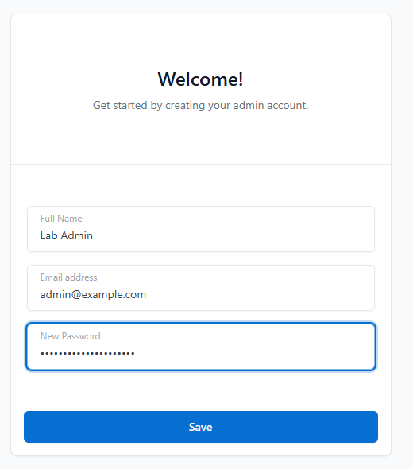\
*เข้า http://127.0.0.1:81 ครั้งแรก: สร้างบัญชี admin*

<a id="npm-step1"></a>
### Step 1 — Proxy Host `localhost` → `http://app:3000`

1. คลิก **Hosts → Proxy Hosts → Add Proxy Host**
2. ในแท็บ **Details** กรอก: **Domain Names** `localhost` (พิมพ์แล้วกด **Enter** ให้กลายเป็น chip) · **Scheme** `http` · **Forward Hostname / IP** `app` · **Forward Port** `3000` ปล่อย Access List และ Options ไว้ตามเดิม (Publicly Accessible และสวิตช์ทุกตัวปิดอยู่)
3. คลิก **Save** ผลที่ควรได้: "Proxy Host has been saved" และมีหนึ่งแถว: `localhost` → `http://app:3000`, HTTP Only, Public, Online

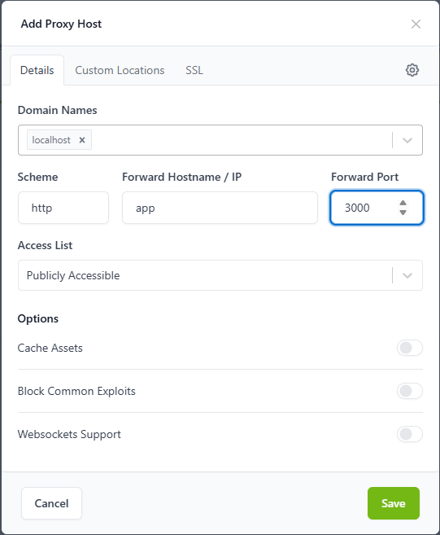\
*แท็บ Details: `localhost` → `http` · `app` · `3000`*

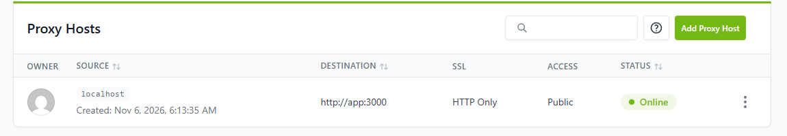\
*หลังกด Save: proxy host มีสถานะ Online*

**ทดสอบ URL เหล่านี้:**

| URL | ผลที่ควรได้ |
| --- | --- |
| http://localhost/health | 200 `{"status":"ok","database":"connected","app":"gacha"}` |
| http://localhost/test | หน้า tester; ปุ่ม **GET · Health + DB** แสดง `GET http://localhost/health` HTTP 200 OK |
| http://localhost/api/catalog | 200 JSON (กติกาและผลที่สุ่มได้) |
| http://localhost/visual/ | 200, visual tester |
| http://localhost/api/accounts/6688123/history | 200; ผลสุ่มจาก 01 ยังอยู่ (volume เดิม) |

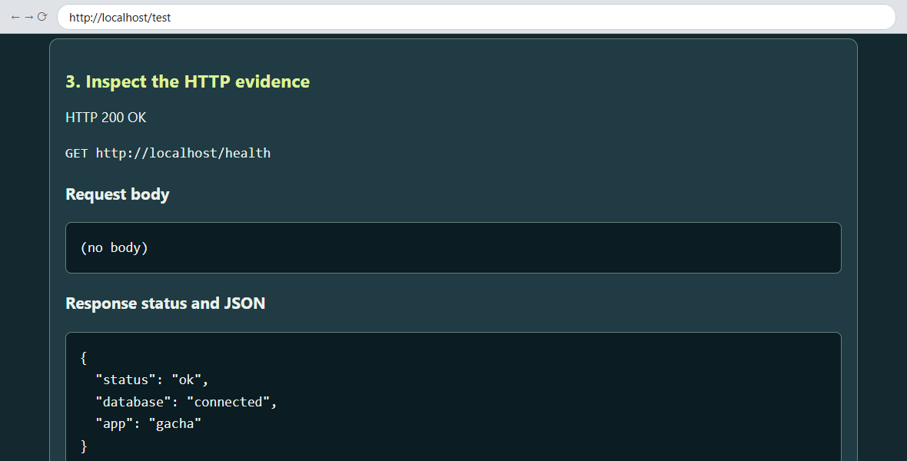\
*http://localhost/test ผ่าน NPM บนพอร์ต 80*

**ทำไมต้องเป็น `app`?** `app` คือชื่อ service ซึ่ง Docker DNS แปลงเป็น IP ได้บน network ที่ `npm` และ `app` ใช้ร่วมกัน ภายใน NPM คำว่า `localhost` ไม่มีทางเป็นแอปของคุณ

> **ไม่บังคับ — ลองใส่ upstream ผิดสักครั้ง (ไม่ต้องใส่ในรายงาน)** **⋮ → Edit** เปลี่ยน Forward Hostname / IP คลิก **Save** แล้วโหลด http://localhost/health ใหม่:
>
> | Forward Hostname / IP | ผลใน browser | เหตุผล |
> | --- | --- | --- |
> | `localhost` | **502 Bad Gateway** (openresty) | NPM แปลงชื่อนี้เป็น IP ไม่ได้ log แสดง `localhost could not be resolved (3: Host not found)` |
> | `127.0.0.1` | **404** `{"error":{"code":404,"message":"Not Found - /health"}}` | admin API ของ NPM เอง ซึ่งฟังพอร์ต 3000 อยู่ภายใน container ของ NPM |
> | `app` | 200 จากแอป gacha | Docker DNS หา container ของแอปเจอ |
>
> ทั้งสามกรณี NPM ยังแสดง **Online** (แปลว่าโหลด configuration สำเร็จ ไม่ได้แปลว่า upstream ใช้งานได้) ดู error จริงได้จาก:
> ```text
> docker compose --env-file .env -f compose.yml -f compose.production.yml -f compose.proxy.yml exec npm sh -c 'tail -n 5 /data/logs/proxy-host-*_error.log'
> ```
>
> 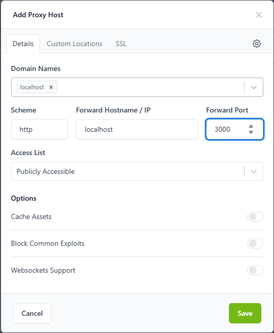\
> *upstream ที่ผิด `localhost` → 502*
>
> **ก่อนทำ Step 2:** ตั้งกลับเป็น `app` คลิก **Save** แล้วตรวจว่า http://localhost/health ได้ 200

<a id="npm-step2"></a>
### Step 2 — Custom Location `/backend/`

เป้าหมาย: แอปตอบภายใต้ `http://localhost/backend/...` ได้ด้วย และแอปยังได้รับ `/test` ไม่ใช่ `/backend/test`

1. ใน **Proxy Hosts** คลิก **⋮** ที่แถว `localhost` → **Edit**
2. เปิดแท็บ **Custom Locations** → **Add Location**
3. กรอก: Location `/backend/` (มี slash ทั้งหน้าและหลัง), Scheme `http`, Forward Hostname / IP `app`, Forward Port `3000`
4. คลิก **รูปเฟือง (gear)** ที่อยู่ทางขวาของช่อง Location ทันที (ไม่ใช่รูปเฟืองระดับ host ที่มุมขวาบน) แล้วพิมพ์ **เพียงบรรทัดนี้**:
   ```nginx
   rewrite ^/backend/(.*)$ /$1 break;
   ```
5. คลิก **Save**

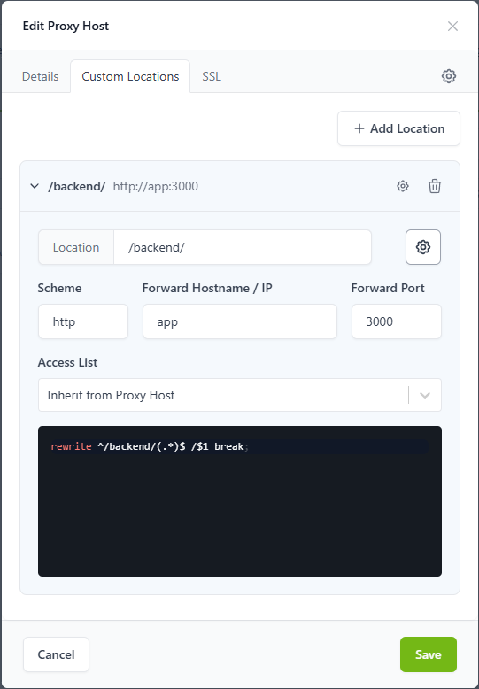\
*Custom Location `/backend/` → `http://app:3000` พร้อมบรรทัด rewrite*

ห้ามวาง block `location { ... }` หรือ `proxy_pass` ลงในตัวแก้ไขรูปเฟือง NPM สร้างส่วนเหล่านั้นเอง ถ้าต้องการอ่านไฟล์ที่ NPM สร้างขึ้น:
```text
docker compose --env-file .env -f compose.yml -f compose.production.yml -f compose.proxy.yml exec npm sh -c 'cat /data/nginx/proxy_host/*.conf'
```

**ทดสอบ URL เหล่านี้:**

| URL | ผลที่ควรได้ | เหตุผล |
| --- | --- | --- |
| http://localhost/backend/test | 200 หน้า tester; ปุ่มต่าง ๆ เรียก `http://localhost/backend/api/...` (Recharge → 201) | rewrite ส่ง `/test` ให้แอป |
| http://localhost/backend/health | 200 health JSON | แอปได้รับ `/health` |
| http://localhost/backend/api/catalog | 200 | |
| http://localhost/backend/visual/ | 200 | |
| http://localhost/backend | **301** → `http://localhost/backend/` | Nginx เติม slash ให้เมื่อ location เป็น `/backend/` |
| http://localhost/backend/ | 200 `{"app":"Gacha Workshop","test":"./test","visual":"./visual/","currency":"virtual demo only"}` | แอปได้รับ `/` |
| http://localhost/backendX | 404 `{"error":"Route not found."}` | ไม่ได้อยู่ใต้ `/backend/` ดังนั้น `location /` จึงส่ง `/backendX` ให้แอป |
| http://localhost/test | ยังได้ 200 | root location ยังส่งต่อทุกอย่างเหมือนเดิม |

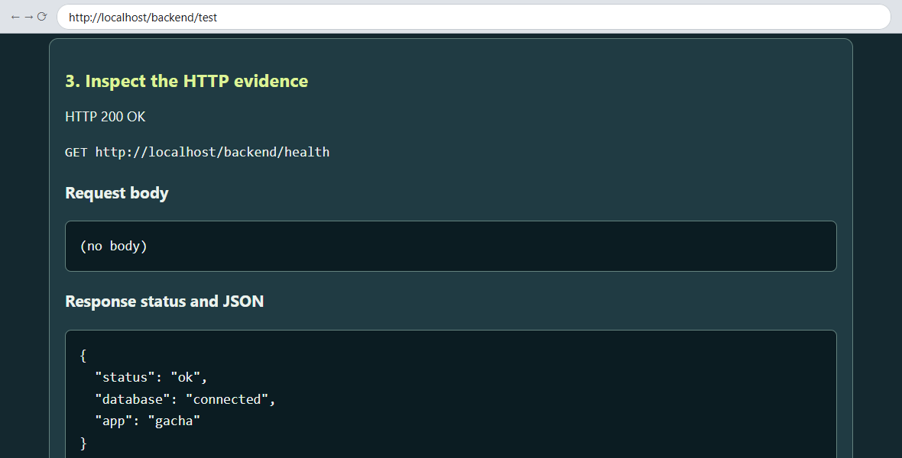\
*หน้า tester คง prefix `/backend` ไว้ในทุกปุ่ม*

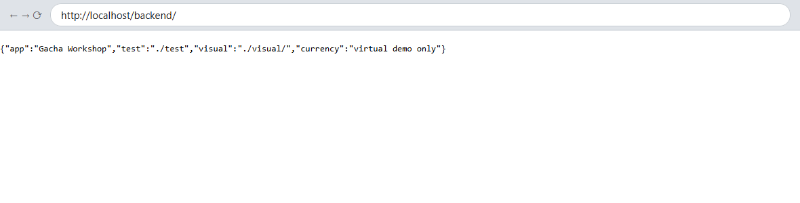\
*`/backend` → 301 → `/backend/` (JSON ที่ root ของแอป)*

**`/backend/` กับ `/backend`: อะไรเปลี่ยนไป**

| Location | Forward Hostname | ตัวแก้ไขรูปเฟือง | `/backend/test` | `/backend` | `/backendX`, `/backend-admin` |
| --- | --- | --- | --- | --- | --- |
| `/backend/` ✓ | `app` | rewrite | 200 | 301 → `/backend/` | ไม่ถูกจับ (ไปที่ `location /`) |
| `/backend` (ไม่มี slash) | `app` | rewrite | 200 | **404** Route not found (แอปได้รับ `/backend` และไม่มี redirect) | **ถูกจับ** โดย location นี้ แล้วส่งต่อแบบไม่เปลี่ยน → 404 |
| `/backend/` | `app` | (ว่าง) | **404** Route not found (แอปได้รับ `/backend/test`) | 301 | – |
| `/backend/` | `app/` | (ว่าง) | 200 (NPM เขียน `proxy_pass http://app:3000/;`) | 301 | – |

ให้ใช้แถวที่ 1 ส่วนแถวที่ 4 เป็นทางเลือกที่ใช้ได้เช่นกัน: path ใน `app/` ทำให้ NPM เขียน `proxy_pass http://app:3000/;` ตามกฎ trailing slash ใน [B](#lab13-ideas)

<a id="npm-step3"></a>
### Step 3 (ในเครื่อง) — ใช้ชื่อของคุณเอง `gacha.test`

1. **ชี้ชื่อนี้มาที่เครื่องของคุณ** เพิ่มบรรทัดนี้ใน hosts file:
   ```text
   127.0.0.1 gacha.test
   ```
   - Windows: Start → พิมพ์ **Notepad** → คลิกขวา → **Run as administrator** → File → Open `C:\Windows\System32\drivers\etc\hosts` (เลือกให้แสดง "All files") → เพิ่มบรรทัดไว้ท้ายไฟล์ → Save
   - macOS/Linux: `sudo nano /etc/hosts` → เพิ่มบรรทัดไว้ท้ายไฟล์ → Ctrl+O, Enter, Ctrl+X
2. **ทดสอบชื่อนี้ก่อนที่ NPM จะรู้จัก:**
   ```text
   curl.exe -i http://gacha.test/backend/test
   ```
   ผลที่ควรได้: `HTTP/1.1 404 Not Found`, `Server: openresty` และ `<center><h1>404 Not Found</h1></center>` ยังไม่มี proxy host ใดใส่ `gacha.test` ไว้ default server ของ NPM จึงเป็นผู้ตอบ: **Host header** เป็นตัวตัดสิน
3. **เพิ่มชื่อใน NPM:** **⋮ → Edit** → **Details** → Domain Names: พิมพ์ `gacha.test` แล้วกด **Enter** (สอง chip: `localhost`, `gacha.test`) → **Save**
4. **ทดสอบ URL เหล่านี้** พิมพ์ `http://` ให้ครบ ไม่เช่นนั้น browser อาจนำคำไปค้นหาแทน

   | URL | ผลที่ควรได้ |
   | --- | --- |
   | http://gacha.test/backend/health | 200 |
   | http://gacha.test/backend/test | 200; Health → `GET http://gacha.test/backend/health` HTTP 200 OK |
   | http://gacha.test/backend | 301 → `/backend/` |
   | http://gacha.test/test | 200 |

5. **ยืนยันว่าชื่อนี้ถูกส่งไปที่ไหน:** `curl.exe -v http://gacha.test/backend/health` แสดง `Trying 127.0.0.1:80`

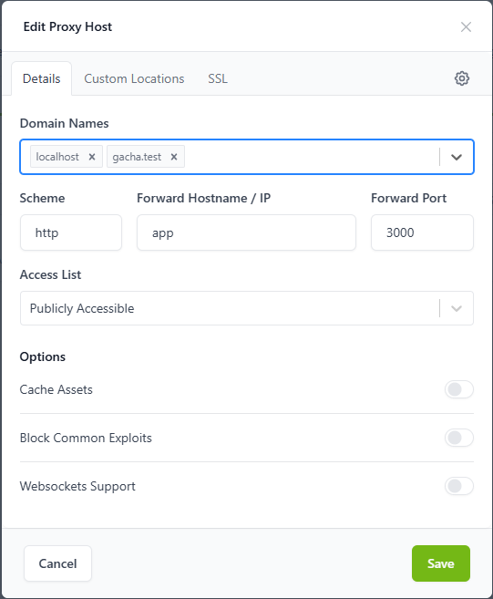\
*proxy host เดียว สองชื่อ*

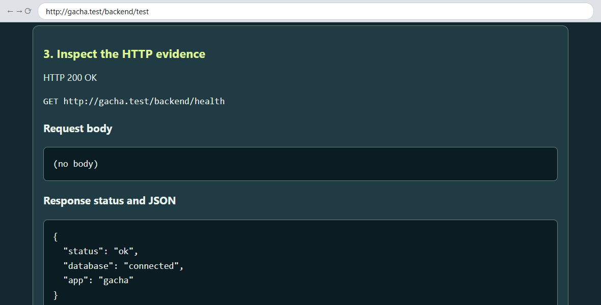\
*hosts file → NPM :80 → Host `gacha.test` → `/backend/` → `app:3000`*

`.test` สงวนไว้สำหรับการทดสอบ (RFC 2606) ไม่มีใครออก public certificate ให้ชื่อนี้ได้

<a id="npm-step3-server"></a>
### Step 3 (บนเซิร์ฟเวอร์) — อะไรเปลี่ยนไปบ้าง

| | แล็ปท็อปของคุณ (แล็บนี้) | Ubuntu VM ในห้องเรียน (04) | Public VPS ที่มีโดเมนจริง |
| --- | --- | --- | --- |
| ใครแปลงชื่อเป็น IP | hosts file บนแล็ปท็อป: `127.0.0.1 gacha.test` | hosts file บน **แล็ปท็อป**: `192.168.1.50 gacha.test` (IP ของ VM) ไม่ต้องแก้อะไรบน VM | DNS record แบบ A/AAAA → public IP ของ server ไม่ใช้ hosts file |
| NPM admin | http://127.0.0.1:81 | SSH tunnel `ssh -L 8181:127.0.0.1:81 student@192.168.1.50` แล้วเปิด http://localhost:8181 | ใช้ SSH tunnel แบบเดียวกัน |
| HTTPS | ไม่มี (`.test` ขอ public certificate ไม่ได้) | ไม่มีในห้องเรียน | แท็บ SSL → **Request a new Certificate** (Let's Encrypt) + **Force SSL** โดยโดเมนต้อง resolve มาที่ server ก่อน และพอร์ต 80 ต้องเข้าถึง NPM ได้ |
| พอร์ตที่ต้องเปิด | ไม่ต้องเปิดอะไร | เฉพาะ LAN ของห้องเรียน | เฉพาะ 80 และ 443 (และ SSH) ห้าม publish 3000, 5432 หรือ 81 |
| URL สำหรับทดสอบ | http://gacha.test/backend/test | http://gacha.test/backend/test | https://your-domain/backend/test |
| CORS | หน้าเว็บจาก origin อื่นต้องอยู่ในรายการ เช่น `http://localhost:5500` | เหมือนกัน | หน้าเว็บจาก origin อื่นต้องอยู่ในรายการ โดยใช้ origin `https://` ที่ตรงตัวทุกตัวอักษร |

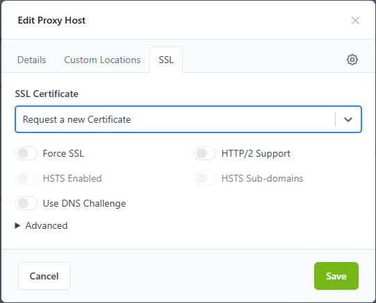\
*แท็บ SSL ใช้กับ server จริงเท่านั้น ห้าม Save ค่านี้สำหรับ `gacha.test`*

บันทึกลงรายงาน: ภาพหน้าจอ NPM ของคุณเอง 4 ภาพ (ฟอร์มใน Step 1, รายการ Proxy Hosts (Online), Custom Location ใน Step 2, Domain Names ใน Step 3); ผลใน browser ของ http://localhost/test, http://localhost/backend/test และ http://gacha.test/backend/test; ตารางผลของ `/backend` เทียบกับ `/backend/` ที่คุณสังเกตได้; แผนภาพเส้นทางของคำขอ (request path); และผลสุ่มจาก 01 ที่ยังอ่านได้

<a id="lab13-03"></a>
## Lab 13 · 03 ทดลอง CORS ด้วย Docker Compose

**origin** คือ scheme + host + port (`http://localhost:5500` ≠ `http://localhost:8085`) **browser** เป็นผู้บังคับใช้ CORS และ API อนุญาตหน้าเว็บโดยส่ง `Access-Control-Allow-Origin` ส่วน `curl` และ Postman ไม่ถูกบล็อกเลย

### Step 0 — เริ่ม local + cors

1. หยุด stack ของ 02 (ข้อมูลและการตั้งค่า NPM ยังอยู่):
   ```text
   docker compose --env-file .env -f compose.yml -f compose.production.yml -f compose.proxy.yml down
   ```
2. ใน `.env` (`notepad .env` / `nano .env`) ตรวจว่าบรรทัดนี้เป็น `CORS_ORIGINS=` โดยไม่มีอะไรต่อท้าย (ถ้าไม่มีให้เพิ่มเข้าไป)
3. ปล่อยพอร์ต 5500 ให้ว่าง: หยุด VS Code Live Server ("Port : 5500" ที่ status bar) และ `npm start` หรือ `python -m http.server` ที่รันอยู่ใน `visual-tester/`
4. เริ่ม base + local + cors service `tester` เสิร์ฟ visual tester จาก **origin ที่สอง** คือ `http://localhost:5500`:
   ```text
   docker compose --env-file .env -f compose.yml -f compose.local.yml -f compose.cors.yml up -d --build --wait
   docker compose --env-file .env -f compose.yml -f compose.local.yml -f compose.cors.yml ps
   ```
   ผลที่ควรได้: `app` `127.0.0.1:8085->3000/tcp` (healthy), `db` `5432/tcp` (healthy), `tester` `127.0.0.1:5500->5500/tcp`
5. อ่าน log ของแอป:
   ```text
   docker compose --env-file .env -f compose.yml -f compose.local.yml -f compose.cors.yml logs app
   ```
   บรรทัดที่ควรเห็น: `CORS_ORIGINS = (empty: only same-origin pages such as /test and /visual/)`

### Step 1 — เริ่มจาก same origin ก่อน (ไม่ต้องใช้ CORS)

เปิด **http://localhost:8085/visual/** → **Connect · GET /health + /api/catalog**
ผลที่ควรได้: "Same origin: this page and the API share http://localhost:8085. No CORS setting is needed." และ health 200 (ปุ่ม **ไทย** แสดงข้อความของ tester เป็นภาษาไทย)

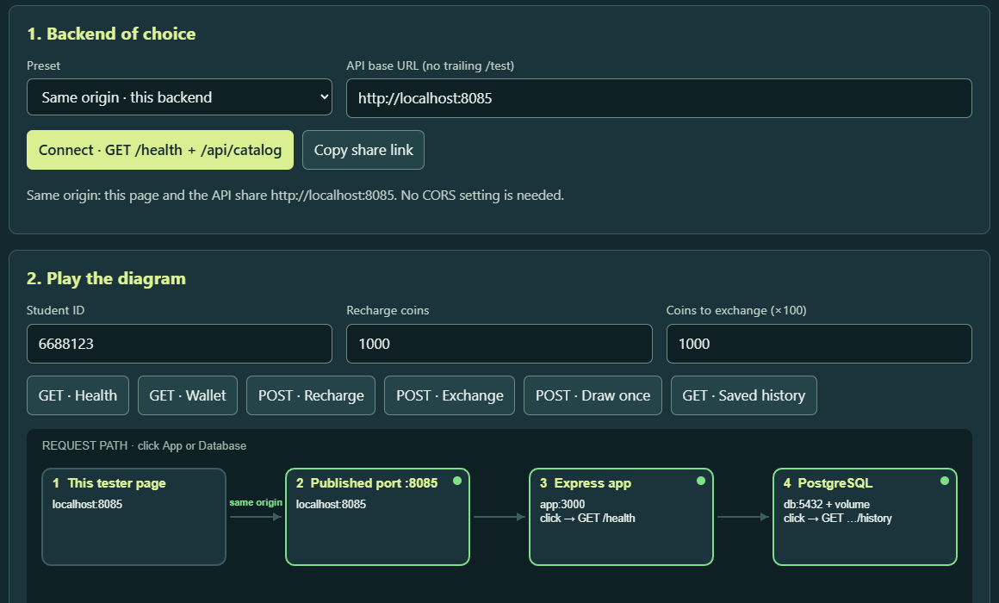\
*แอปเสิร์ฟหน้าเว็บเอง: origin เดียว*

### Step 2 — origin ที่สองถูกบล็อก

1. เปิด **http://localhost:5500** → preset **Local direct port · localhost:8085** → **Connect**
   ผลที่ควรได้: **CORS** ✕ สีแดงที่ page node และข้อความบอกให้ใส่ `CORS_ORIGINS=http://localhost:5500` ใน `.env`
2. **F12** (macOS: Cmd+Option+I) → **Console** ผลที่ควรได้: `Access to fetch at 'http://localhost:8085/health' from origin 'http://localhost:5500' has been blocked by CORS policy: No 'Access-Control-Allow-Origin' header is present on the requested resource.`
3. พิสูจน์ว่า server **ตอบจริง**:
   ```text
   curl.exe -i -H "Origin: http://localhost:5500" http://localhost:8085/health
   ```
   ผลที่ควรได้: `HTTP/1.1 200 OK` และ `{"status":"ok","database":"connected","app":"gacha"}` แต่ **ไม่มี** บรรทัด `Access-Control-Allow-Origin`
4. รันคำสั่ง `logs app` จาก Step 0 อีกครั้ง ผลที่ควรได้: `CORS: page origin http://localhost:5500 is not in CORS_ORIGINS (empty). The browser will hide responses from that page.`

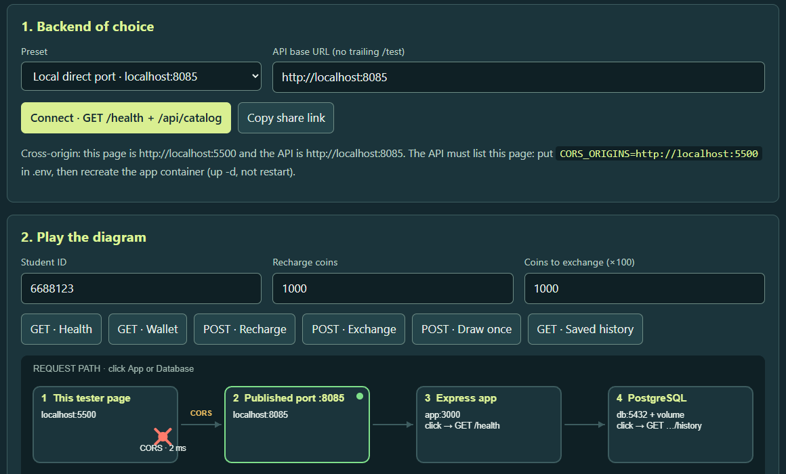\
*`CORS_ORIGINS` ว่าง: browser ซ่อนคำตอบไว้*

### Step 3 — แก้ `.env` แล้วสั่ง `restart` (ไม่ช่วย)

1. ใน `.env` ตั้ง `CORS_ORIGINS=http://localhost:5500` แล้วบันทึก
2. Restart แอป แล้วดูค่าภายใน container:
   ```text
   docker compose --env-file .env -f compose.yml -f compose.local.yml -f compose.cors.yml restart app
   docker compose --env-file .env -f compose.yml -f compose.local.yml -f compose.cors.yml exec app printenv CORS_ORIGINS
   ```
   ผลที่ควรได้: **บรรทัดว่าง** curl จาก Step 2 และ tester ยังถูกบล็อก

เหตุผล: `restart` ใช้ container ตัวเดิม ซึ่ง environment ถูกกำหนดไว้ตั้งแต่ตอนสร้าง ส่วน `up -d` สร้าง container ขึ้นใหม่

### Step 4 — `up -d` สร้าง container ใหม่ (แก้ได้)

1. สร้าง container ของแอปใหม่ แล้วดูค่าภายในอีกครั้ง:
   ```text
   docker compose --env-file .env -f compose.yml -f compose.local.yml -f compose.cors.yml up -d --wait app
   docker compose --env-file .env -f compose.yml -f compose.local.yml -f compose.cors.yml exec app printenv CORS_ORIGINS
   ```
   ผลที่ควรได้: `http://localhost:5500` และคำสั่ง `logs app` จะจบด้วย `CORS_ORIGINS = http://localhost:5500`
2. รัน curl จาก Step 2 ซ้ำ ผลที่ควรได้: `HTTP/1.1 200 OK` พร้อม `Vary: Origin` และ `Access-Control-Allow-Origin: http://localhost:5500`
3. ใน tester ที่ http://localhost:5500 พิมพ์รหัสนักศึกษา **ของคุณ** → **Connect** → **POST · Recharge**, **POST · Exchange**, **POST · Draw once**, **GET · Saved history**
   ผลที่ควรได้: "Cross-origin and allowed ✓"; health 200, recharge 201, exchange 201, draw 201, history 200
4. ตรวจ **preflight** แบบ `OPTIONS` ที่ browser ส่งก่อน `POST` แบบ JSON ทุกครั้ง:
   ```text
   curl.exe -i -X OPTIONS http://localhost:8085/api/draw -H "Origin: http://localhost:5500" -H "Access-Control-Request-Method: POST" -H "Access-Control-Request-Headers: content-type"
   ```
   ผลที่ควรได้:
   ```text
   HTTP/1.1 204 No Content
   Vary: Origin
   Access-Control-Allow-Origin: http://localhost:5500
   Access-Control-Allow-Methods: GET, POST, OPTIONS
   Access-Control-Allow-Headers: Content-Type
   Access-Control-Max-Age: 600
   ```

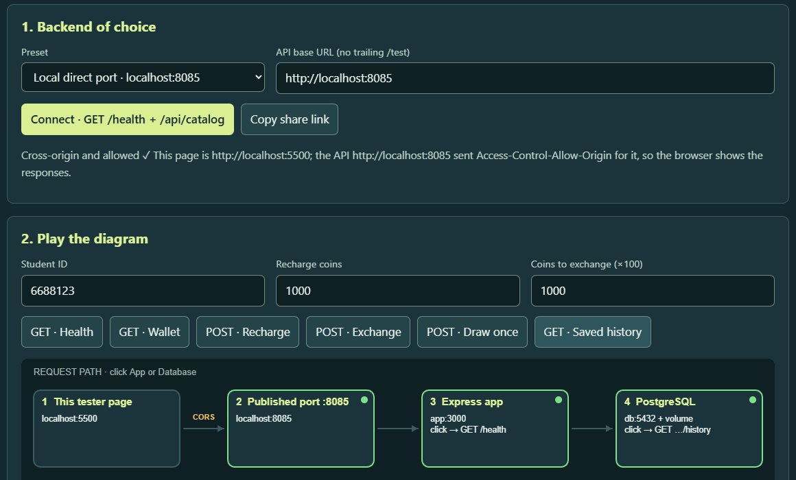\
*หลัง `up -d`: ทุก node เป็นสีเขียว*

### Step 5 — กับดัก exact origin

1. เปิด **http://127.0.0.1:5500** → **Connect** ผลที่ควรได้: CORS ✕ และ "Careful: http://127.0.0.1:5500 and http://localhost:5500 are different origins. List exactly the origin in your address bar."
2. Console ระบุ `origin 'http://127.0.0.1:5500'` และ log ของแอปแสดง `CORS: page origin http://127.0.0.1:5500 is not in CORS_ORIGINS (http://localhost:5500). The browser will hide responses from that page.`
3. วิธีแก้: เปิด origin ที่อยู่ในรายการ (`http://localhost:5500`) **หรือ** ใส่ทั้งสองค่าใน `.env` (คั่นด้วย comma ไม่มี path ไม่มี `/` ท้าย): `CORS_ORIGINS=http://localhost:5500,http://127.0.0.1:5500` จากนั้นสร้าง container ของแอปใหม่:
   ```text
   docker compose --env-file .env -f compose.yml -f compose.local.yml -f compose.cors.yml up -d --wait app
   ```

VS Code Live Server เปิด `http://127.0.0.1:5500` และ `http.server` ของ Python พิมพ์ `http://0.0.0.0:5500`: ทั้งสองแบบเป็นคนละ origin กับ `http://localhost:5500`

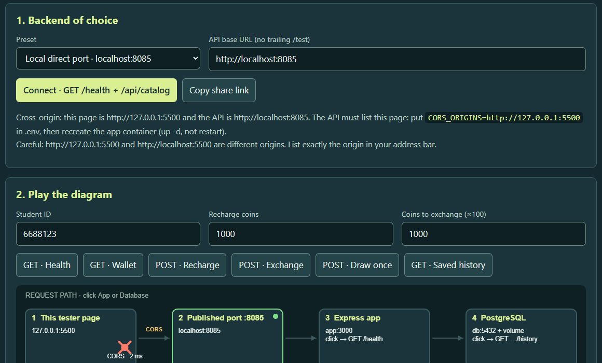\
*เครื่องเดียวกัน แต่คนละ origin*

### Step 6 (ไม่บังคับ) — same origin ผ่าน proxy

1. สลับไปใช้ production + proxy + cors (ข้อมูลและ proxy host ของ NPM ยังอยู่):
   ```text
   docker compose --env-file .env -f compose.yml -f compose.local.yml -f compose.cors.yml down
   docker compose --env-file .env -f compose.yml -f compose.production.yml -f compose.proxy.yml -f compose.cors.yml up -d --build --wait
   ```
2. เปิด **http://gacha.test/backend/visual/** พิมพ์รหัสนักศึกษาของคุณ → **Connect**
   ผลที่ควรได้: "Same origin: this page and the API share http://gacha.test. No CORS setting is needed." และ Recharge, Exchange, Draw once ได้ 201
3. เปิด **http://localhost:5500/?api=http://gacha.test/backend** → **Connect** กรณีนี้กลับเป็น cross-origin อีกครั้ง และใช้ได้เพียงเพราะ `CORS_ORIGINS` มี `http://localhost:5500` อยู่

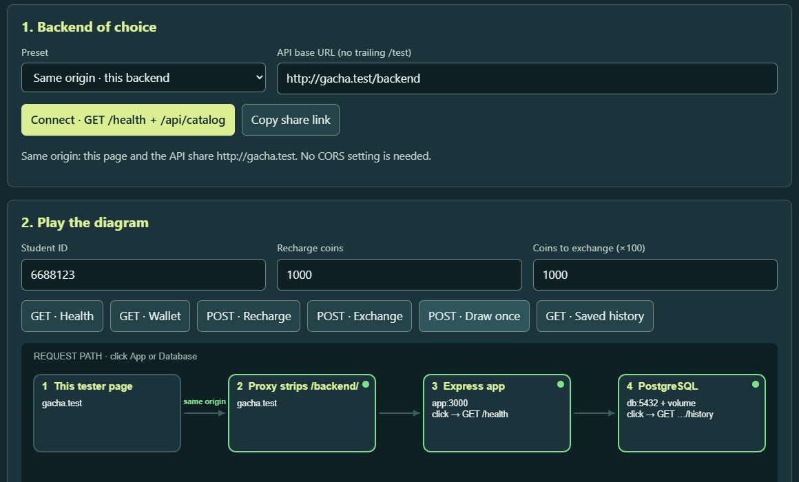\
*หน้าเว็บและ API มาผ่าน NPM ที่ `http://gacha.test` ทั้งคู่*

**บทเรียน:** reverse proxy ที่เสิร์ฟหน้าเว็บ **และ** API ภายใต้ origin เดียว ทำให้ไม่ต้องใช้ CORS

เมื่อทำเสร็จ ให้หยุดสิ่งที่กำลังรันอยู่ (ไม่ใส่ `-v`):
```text
# after Step 6
docker compose --env-file .env -f compose.yml -f compose.production.yml -f compose.proxy.yml -f compose.cors.yml down
# if you skipped Step 6
docker compose --env-file .env -f compose.yml -f compose.local.yml -f compose.cors.yml down
```

### Checklist ของ CORS

| อาการ | ตรวจอะไร | วิธีแก้ |
| --- | --- | --- |
| tester แสดง CORS ✕ แต่ `curl` ได้ 200 | origin ของหน้าเว็บ (ดูจากช่อง address) อยู่ใน `CORS_ORIGINS` หรือไม่ | เพิ่ม origin ให้ตรงตัว แล้วรัน `up -d --wait app` |
| ยัง ✕ อยู่หลังแก้ `.env` | `exec app printenv CORS_ORIGINS` พิมพ์ค่าว่างหรือค่าเก่า | คุณใช้ `restart` ให้รัน `up -d --wait app` แทน |
| ใช้ได้ที่ `localhost:5500` แต่ไม่ได้ที่ `127.0.0.1:5500` | เทียบช่อง address กับ `CORS_ORIGINS` | เปิด origin ที่อยู่ในรายการ หรือใส่ทั้งสองค่า |
| origin ที่ใส่ไว้แล้วยังถูกบล็อก | ใส่ path ไปด้วยหรือเปล่า เช่น `http://localhost:5500/index.html` | origin ไม่มี path (แอปนี้ไม่สนใจ `/` ท้ายสุดหนึ่งตัว) |
| หน้า `https://` เรียก API แบบ `http://` | tester แสดง "Blocked as mixed content" | ใช้ URL ของ API แบบ HTTPS หรือรัน tester ในเครื่องผ่าน `http` |
| visual tester ที่โฮสต์ไว้บนเว็บ Lab 13 ใช้ไม่ได้ | หน้านั้นเป็นหน้า `https://` | ใช้ได้เฉพาะกับ backend ที่เป็น HTTPS และมี `https://pisit-devop.com` ใน `CORS_ORIGINS` ด้วย สำหรับ Lab 13 ให้ใช้ `/visual/` ของแอปเอง (same origin) หรือ tester จาก `compose.cors.yml` ที่ `http://localhost:5500` |
| เปิดหน้าเว็บแบบ `file://` | tester บอกว่า origin เป็น "null" | เสิร์ฟผ่าน http เช่นใช้ service `tester` จาก `compose.cors.yml` |
| ตั้ง `CORS_ORIGINS=*` | ทุก origin ได้รับอนุญาต | ยอมรับได้เฉพาะ API ในห้องเรียนนี้ที่ไม่มี authentication กรณีอื่นให้ระบุ origin ตรงตัว |

บันทึกลงรายงาน: ภาพหน้าจอตอนถูกบล็อก + curl ที่ไม่มี `Access-Control-Allow-Origin` + บรรทัด log ของแอป; `printenv` หลัง `restart` (ว่าง) เทียบกับหลัง `up -d`; ภาพหน้าจอตอนได้รับอนุญาต + preflight 204; กับดัก `127.0.0.1`; และหนึ่งประโยคอธิบายว่าทำไมหน้าเว็บที่เป็น same origin ผ่าน proxy จึงไม่ต้องใช้ CORS

<a id="lab13-04"></a>
## Lab 13 · 04 ใช้ Ubuntu VM เป็นเซิร์ฟเวอร์

ไฟล์ชุดเดิมบน Docker host อีกเครื่องหนึ่ง (รายละเอียดอยู่ในเว็บ Lab 13) เปลี่ยน `192.168.1.50` และ `student` เป็น address และชื่อผู้ใช้ของ VM ของคุณ

1. **เข้าถึง VM** ใน VM รัน `ip -br address` เพื่อดู IP จากแล็ปท็อป: `ssh student@192.168.1.50`
2. **ตรวจ Docker Engine** ใน VM (ถ้ายังไม่มี ให้ติดตั้งจาก apt repository ทางการของ Docker) ทั้ง Client และ Server ต้องตอบ:
   ```bash
   sudo docker version
   sudo docker compose version
   ```
3. **คัดลอก source ไม่ใช่ข้อมูล** ที่ VM: `mkdir -p ~/apps` ที่แล็ปท็อป: `scp gacha-workshop.zip student@192.168.1.50:~/apps/` จากนั้นใน VM สร้าง `.env` **ใหม่** (รหัสนักศึกษาของคุณ และรหัสผ่านใหม่) ฐานข้อมูลบน VM เริ่มต้นว่าง:
   ```bash
   sudo apt install unzip
   cd ~/apps && unzip gacha-workshop.zip && cd gacha-workshop
   cp .env.example .env
   nano .env
   ```
4. **เริ่ม production + proxy** ใน VM ผลที่ควรได้: พอร์ตเหมือนใน [02 Step 0](#npm-step0)
   ```bash
   sudo docker compose --env-file .env -f compose.yml -f compose.production.yml -f compose.proxy.yml up -d --build --wait
   sudo docker compose --env-file .env -f compose.yml -f compose.production.yml -f compose.proxy.yml ps
   ```
5. **เปิด NPM ผ่าน SSH tunnel** บนแล็ปท็อป เปิด `ssh -L 8181:127.0.0.1:81 student@192.168.1.50` ค้างไว้ แล้วสร้างบัญชี admin ที่ http://localhost:8181 พอร์ต 81 ไม่ถูก publish เลย
6. **ทำ [02 Steps 1–3](#npm-step1) ซ้ำใน NPM ของ VM:** Domain Names `localhost` และ `gacha.test` → `http` · `app` · `3000` และ Custom Location `/backend/` พร้อมบรรทัด rewrite
7. **ชี้แล็ปท็อปไปที่ VM** เมื่อใช้เครือข่ายแบบ bridged ให้เปลี่ยนบรรทัดใน hosts file ของแล็ปท็อปเป็น `192.168.1.50 gacha.test` (ดู [Step 3 บนเซิร์ฟเวอร์](#npm-step3-server)) ถ้าใช้ NAT ให้ใช้ port forwarding ของ hypervisor
8. **ทดสอบ** http://gacha.test/backend/test: Health → Wallet → Recharge → Exchange → Draw once → Saved history แล้วจด `id` และ `created_at` ของผลสุ่ม
9. **พิสูจน์ว่าข้อมูลบน VM ยังอยู่** (ไม่ใส่ `-v`) จด ID ของ container แอป สร้าง container ใหม่แทน แล้วแสดง ID ใหม่:
   ```bash
   sudo docker compose --env-file .env -f compose.yml -f compose.production.yml -f compose.proxy.yml ps -q app
   sudo docker compose --env-file .env -f compose.yml -f compose.production.yml -f compose.proxy.yml up -d --force-recreate --wait app
   sudo docker compose --env-file .env -f compose.yml -f compose.production.yml -f compose.proxy.yml ps -q app
   ```
   ผลที่ควรได้: ID ของ container เปลี่ยนไป และ **GET · Saved history** ยังแสดงผลสุ่มเดิม
10. **เฉพาะ Public VPS:** `sudo ufw allow OpenSSH`, `sudo ufw allow 80/tcp`, `sudo ufw allow 443/tcp` แล้วจึง `sudo ufw enable` พอร์ตที่ Docker publish อาจข้าม UFW ได้ ดังนั้นต้องไม่ publish 3000, 5432 และ 81

<a id="lab14"></a>
## Lab 14 · CI/CD ใน 5 ขั้นตอน

บทเรียนเต็ม สไลด์ และรายงาน: [เว็บ Lab 14](https://pisit-devop.com/itcs258/Lab14/)  
โฟลเดอร์นี้จะกลายเป็น **root** ของ GitHub repository ของคุณเอง  
ใช้ชุดที่ดาวน์โหลดจากเว็บ Lab 14 เพราะชุดของ Lab 13 ไม่มี `.github/workflows/`

คำศัพท์ บรรทัดละคำ:
- **Commit** = ภาพบันทึกของไฟล์ ณ เวลาหนึ่ง
- **SHA** = รหัสของ commit ใช้ 7 ตัวแรกก็พอ
- **Branch** = สายงานแยก
- **Pull request** = คำขอ merge branch หนึ่งเข้า `main`
- **CI** = โค้ดที่ push เข้า `main` และทุก pull request จะถูก test อัตโนมัติ
- **CD** = deploy เฉพาะโค้ดที่ผ่าน test
- **Job** = ส่วนหนึ่งของ workflow
- **Runner** = เครื่องชั่วคราวที่รัน job
- **Check** = เครื่องหมาย ✓ / ✕ ที่ติดกับ commit หรือ pull request
- **Secret** = ค่าที่ให้สิทธิ์เข้าถึง

```text
git push → GitHub Actions: test → integration → publish → ✓ checks → Render / Railway deploys → tester shows the new version
```

**Step 0 · Repository ของตัวเอง**
1. สร้าง `.env` ตาม [Lab 12 ขั้นที่ 1](#lab12)
2. บน GitHub: **+** → **New repository** → ตั้งชื่อ → **Create repository** ปล่อยให้ว่าง แนะนำแบบ Public
3. ใช้ Git บนเครื่องนี้ครั้งแรก? รัน `git config --global user.name "Your Name"` และ `git config --global user.email "you@example.com"`
4. รันในโฟลเดอร์นี้ (โฟลเดอร์ที่เห็น `compose.yml`):
```text
git init
git add .
git commit -m "gacha workshop"
git branch -M main
git remote add origin https://github.com/YOUR-USER/YOUR-REPO.git
git push -u origin main
git ls-files .env
```
ผลที่ควรได้: คำสั่งสุดท้ายไม่แสดงอะไร  
เพราะ `.gitignore` กัน `.env` (ที่มีรหัสผ่าน) ไม่ให้เข้า Git  
push ครั้งแรกจะให้ sign in กับ GitHub ถ้าถามรหัสผ่าน ให้ใช้ personal access token (แบบ classic ติ๊ก **repo** และ **workflow**)

**01 · CI ทุกครั้งที่ push เข้า `main` และทุก pull request**
- แท็บ **Actions** → workflow **"CI/CD"** → `test` ✓ → `integration` ✓ → `publish` ✓
- `publish` รันเฉพาะ `main`
- log ของ `test` แสดง test ผ่าน 11 ตัว และจาก `test/check-compose.js`:
```text
PASS  production app publishes no host port
PASS  production db publishes no host port
```

**02 · ทำให้พัง แล้วแก้**
1. `git switch -c break-a-test`
2. ใน `test/domain.test.js` แก้ `size, 5)` เป็น `size, 6)`
3. `git commit -am "break a test on purpose"` แล้ว `git push -u origin break-a-test`
4. บน GitHub: **Compare & pull request** → **Create pull request**
5. ผลที่ควรได้: ✕ สีแดงที่ **"CI/CD / test (pull_request)"**
6. แก้กลับ แล้ว commit และ push ผลที่ควรได้: ✓ สีเขียว
7. **Merge pull request** → **Confirm merge** แล้ว `main` จะรัน pipeline ครบ รวม `publish`
8. บนแล็ปท็อป: `git switch main` แล้ว `git pull`
9. ไม่บังคับ: **Settings → Rules → Rulesets** → **"Require status checks to pass before merging"** (บัญชีฟรีต้องเป็น repository แบบ public)

job `integration` เปิดแอปจริง + PostgreSQL บน runner  
จากนั้นรัน smoke test แล้วปิดด้วย `down -v`  
step **"Smoke test"** แสดงผลนี้ (CI ตั้ง `SMOKE_ORIGIN` และ `CORS_ORIGINS` ไว้ บรรทัด CORS จึงขึ้น):
```text
Smoke test http://localhost:8085  student smoke-mw4o3ftv
PASS  GET /health → 200 and database connected  (version dev)
PASS  POST /api/recharge 1000 → 201  (coins 1000)
PASS  POST /api/exchange 1000 → 201 and 10 gems
PASS  POST /api/draw → 201 with a saved draw  (Wind Fox)
PASS  POST /api/draw without gems → 409
PASS  GET history shows the draw
PASS  CORS preflight from http://localhost:5500 → 204
All smoke checks passed
```
บนแล็ปท็อป `npm run smoke -- http://localhost:8085` จะแสดง `PASS` หกบรรทัดแรก  
บรรทัด CORS จะขึ้นเมื่อ `SMOKE_ORIGIN` และ `CORS_ORIGINS` เป็น `http://localhost:5500` ทั้งคู่เท่านั้น

**03 · Image ที่ผ่าน test**
- หน้า repository → **Packages** → tag `main` และ tag `<short sha>` หนึ่งตัวต่อการ push เข้า `main` หนึ่งครั้ง
- package ใหม่เป็น private
- เปลี่ยนเป็น public: **Package settings → Change visibility → Public** (เปลี่ยนกลับเป็น private ไม่ได้)
- หรือเก็บเป็น private แล้วรัน `docker login ghcr.io` ก่อน
- ใช้ชื่อตัวพิมพ์เล็ก:
```text
docker pull ghcr.io/YOUR-USER/YOUR-REPO:main
docker run --rm ghcr.io/YOUR-USER/YOUR-REPO:main node -e "console.log(process.env.GIT_SHA)"
```
ผลที่ควรได้: commit SHA แบบเต็ม  
job `publish` login ด้วย `GITHUB_TOKEN` จึงไม่ต้องสร้าง secret เอง

**04 · Deploy หลัง CI ผ่าน**
- Render (ทางหลัก):
  1. **New → Postgres** (Free) → คัดลอก **Internal Database URL**
  2. **New → Web Service** → repository นี้ ถ้าไม่เห็น ให้เชื่อม GitHub และอนุญาตให้ Render เข้าถึง
  3. Language `Docker`, Region = region ของฐานข้อมูล, Root Directory เว้นว่าง, Instance type `Free`, Health Check Path `/health`
  4. Environment: `DATABASE_URL` = URL นั้น, `CORS_ORIGINS` = `http://localhost:5500` แล้วจึงสร้าง service
  5. **Settings → Auto-Deploy → "After CI Checks Pass"** (Blueprint: `render.yaml`, `autoDeployTrigger: checksPass`)
- Railway (ทางเลือก):
  1. PostgreSQL + ตัวแปรของ app `DATABASE_URL=${{Postgres.DATABASE_URL}}` และ `CORS_ORIGINS=http://localhost:5500`
  2. เปิด **"Wait for CI"** ใน service settings
  3. สร้าง public domain ให้ app service
- เปิด tester ในเครื่อง:
  ```text
  docker compose --env-file .env -f compose.yml -f compose.local.yml -f compose.cors.yml up -d --wait tester
  ```
- เปิด `http://localhost:5500/?api=https://YOUR-APP.onrender.com` → **Connect**
- Health แสดง `"version"` = commit ล่าสุดบน `main` ของคุณ
- CORS ✕? แก้ `CORS_ORIGINS` บน platform ไม่ใช่ใน `.env` แล้วรอ deploy ใหม่
- tester ที่โฮสต์บนเว็บ Lab 14 ใช้ได้ก็ต่อเมื่อ `CORS_ORIGINS` มี `https://pisit-devop.com` ด้วย
- อยู่บน `main` (`git switch main` แล้ว `git pull`) แล้ว push การแก้ไขเล็ก ๆ
- ดูลำดับ: Actions ✓ → platform deploy → `version` เปลี่ยน
- smoke test กับแอปจริง: `node test/smoke.js https://YOUR-APP.onrender.com` (`PASS` หกบรรทัด และเจ็ดบรรทัดเมื่อตั้ง `SMOKE_ORIGIN`)
- Free tier: web service ของ Render หลับหลังว่าง 15 นาที คำขอแรกหลังจากนั้นใช้เวลาประมาณ 1 นาที
- Render Postgres ฟรีหมดอายุใน 30 วัน

**05 · Secret ทีละแนวคิด**
- secret คือค่าที่ให้สิทธิ์เข้าถึง: รหัสผ่านฐานข้อมูล, `DATABASE_URL`, token
- โค้ดถูกคัดลอกไปทุกที่ secret จึงต้องไม่อยู่ในโค้ด
- โค้ด → Git
- secret → ที่ที่รันโค้ด
- ตัวแปรของ Render / Railway เก็บ `DATABASE_URL` และแอปอ่านด้วย `process.env`
- `CORS_ORIGINS` อยู่ที่นั่นด้วย แต่เป็นค่าตั้งธรรมดา ไม่ใช่ secret
- GitHub **Settings → Secrets and variables → Actions** เก็บ secret ของ workflow (`${{ secrets.NAME }}`)
- GitHub แสดง secret เหล่านั้นเป็น `***` ใน log
- ฐานข้อมูลใน CI ใช้ค่าตัวอย่างจาก `.env.example` เพราะถูกทิ้งด้วย `down -v`
- GitHub สร้าง `GITHUB_TOKEN` ใหม่ให้ทุก job และ token หมดอายุเมื่อ job จบ
- ปลอดภัยกว่า: ถ้า repository หรือ zip หลุด รหัสผ่านก็ไม่หลุดไปด้วย
- ปลอดภัยกว่า: แต่ละ environment (แล็ปท็อป, production) มีรหัสผ่านของตัวเอง
- ปลอดภัยกว่า: เปลี่ยนรหัสผ่านได้โดยไม่ต้อง commit ใหม่
- ปลอดภัยกว่า: คนที่เห็นค่าได้มีน้อยลง
- ห้าม commit `.env`
- ห้ามวาง secret ใน YAML, Dockerfile, README หรือภาพหน้าจอ
- ถ้า secret หลุด ให้เปลี่ยนค่าก่อน
- แล้วค่อยเก็บกวาด (ลบออกจากไฟล์และ history ของ Git)
- ไม่บังคับ: repository secret `DEMO_SECRET` → **Actions → "Secret demo" → Run workflow** → log แสดง `***`

ค้นคว้าเพิ่มเติม (ไม่ใช่ส่วนของ Lab 14): แนวคิด pipeline เดียวกันใช้ deploy ไปยัง Ubuntu server ของตัวเองได้

<a id="folder-map"></a>
## แผนผังโฟลเดอร์

```text
gacha/                          # gacha-workshop/ in the download
├── compose*.yml                # base + overlays: see the table in "Before you start · A"
├── .github/workflows/          # Lab 14: ci-cd.yml (test → integration → publish), secret-demo.yml (manual, shows ***)
├── .env.example / .env         # safe template / your values (ignored by Git and the image build)
├── .env.*.example              # optional templates for separate local/staging/production files
├── Dockerfile, app.js, domain.js, server.js
├── db/init.sql                 # schema; read-only bind mount into the db container
├── public/                     # test.html (/test), api-spec.html (/api-spec)
├── openapi.json                # OpenAPI 3 file (/openapi.json)
├── render.yaml                 # Lab 14 platform deploy (After CI Checks Pass)
├── visual-tester/              # p5.js request-path tester (/visual/ and the tester service)
├── docs/images/                # the screenshots used in this guide
├── README.en.md / README.md    # this guide in English / Thai
└── test/                       # domain + http tests (11); smoke.js, check-compose.js (Lab 14 CI); optional integration.py
```

`render.yaml` คือ Render Blueprint แบบไม่บังคับของ Lab 14 (`autoDeployTrigger: checksPass`) ส่วน `visual-tester/vercel.json` เป็นส่วนเสริมที่ไม่ได้ใช้ในขั้นตอนของ lab `pgdata` mount ที่ `/var/lib/postgresql` ส่วน `db/init.sql` รันเฉพาะตอนที่ data directory ยังว่าง การเปลี่ยน schema ที่มีอยู่แล้วต้องทำผ่าน migration ที่ผ่านการ review

<a id="api-contract"></a>
## API contract

| Method | Route | Input / ผลลัพธ์ |
| --- | --- | --- |
| GET | `/health` | รัน `SELECT 1` จริง; HTTP 200 เมื่อ connected หรือ 503 เมื่อ unavailable |
| GET | `/api/catalog` | กติกาที่กำหนดไว้ตายตัวและผล SSR ทั้งห้าแบบ |
| GET | `/api/accounts/:studentId` | สร้างกระเป๋าว่างถ้ายังไม่มี แล้วอ่านค่า |
| POST | `/api/recharge` | `{"student_id":"6688123","coins":1000}`; เพิ่ม coin จำลอง |
| POST | `/api/exchange` | field เหมือนกัน; coins ต้องเป็นผลคูณของ 100 |
| POST | `/api/draw` | `{"student_id":"6688123"}`; ใช้ 10 gem แล้วคืนผลสุ่มที่บันทึกแล้ว |
| GET | `/api/accounts/:studentId/history` | transaction และผลสุ่มล่าสุด 50 รายการ |
| GET | `/test` | tester สองภาษา ส่ง HTTP request ด้วยการกดปุ่ม |
| GET | `/visual/` | visual tester แบบ p5.js (same origin) |

Status code: การเขียนข้อมูล **201**, input ไม่ถูกต้อง **400**, ยอดไม่พอ **409**, ฐานข้อมูลใช้งานไม่ได้ **503** จำนวนเป็นจำนวนเต็ม (recharge/exchange ครั้งละ 1–100000 coin; ยอดคงเหลือไม่เกิน 1000000) รหัสนักศึกษาใช้ตัวอักษร ตัวเลข `_` หรือ `-` ยาว 1–30 ตัว
การทำงานกับกระเป๋าแต่ละครั้งเกิดขึ้นใน transaction เดียวที่มี row lock และใช้ parameterized SQL การสุ่มสองครั้งพร้อมกันจึงใช้ 10 gem ชุดเดียวกันไม่ได้

<a id="ssr-odds"></a>
## ทำไม SSR 2% จึงเท่ากับ 0.4% ต่อผล legendary แต่ละแบบ

server เลือก SSR เมื่อ `crypto.randomInt(100)` ได้ 0 หรือ 1 จากนั้น `crypto.randomInt(5)` เลือกหนึ่งใน **Aurora Dragon, Chrono Phoenix, Celestial Tiger, Nebula Knight, Ocean Empress**: แต่ละแบบจึงมีโอกาส `0.02 × 1/5 = 0.004` (0.4%)
การสุ่มแต่ละครั้งเป็นอิสระต่อกัน: ไม่มีตัวนับ pity ไม่มีการรับประกัน SSR และ API ไม่รับค่าการสุ่มจาก client

<a id="command-line"></a>
## แบบฝึกบน command line

คำสั่งชุดนี้ทำแบบเดียวกับปุ่มใน `/test` ถ้าเรียกผ่าน NPM ให้ใช้ base `http://localhost/backend` แทน `http://localhost:8085`
```powershell
# Windows PowerShell
$base = 'http://localhost:8085'
$id = '6688123'
Invoke-RestMethod "$base/health"
Invoke-RestMethod -Method Post -Uri "$base/api/recharge" -ContentType 'application/json' -Body (@{student_id=$id;coins=1000}|ConvertTo-Json)
Invoke-RestMethod -Method Post -Uri "$base/api/exchange" -ContentType 'application/json' -Body (@{student_id=$id;coins=1000}|ConvertTo-Json)
$proof = Invoke-RestMethod -Method Post -Uri "$base/api/draw" -ContentType 'application/json' -Body (@{student_id=$id}|ConvertTo-Json)
$proof | ConvertTo-Json -Depth 5
Invoke-RestMethod "$base/api/accounts/$id/history" | ConvertTo-Json -Depth 5
```

```bash
# macOS / Linux
curl -i http://localhost:8085/health
curl -i -X POST http://localhost:8085/api/recharge -H 'Content-Type: application/json' -d '{"student_id":"6688123","coins":1000}'
curl -i -X POST http://localhost:8085/api/exchange -H 'Content-Type: application/json' -d '{"student_id":"6688123","coins":1000}'
curl -i -X POST http://localhost:8085/api/draw -H 'Content-Type: application/json' -d '{"student_id":"6688123"}'
curl -i http://localhost:8085/api/accounts/6688123/history
```
ระหว่างพิสูจน์ว่าข้อมูลยังอยู่ ให้ใช้เฉพาะคำสั่ง `history` ห้ามสุ่มใหม่

<a id="api-spec"></a>
## API specification

เปิด `/api-spec` บนแอปที่กำลังรันเพื่อดูเอกสารสองภาษา หรือนำเข้า `/openapi.json` ใน Postman (ตั้ง server URL ให้ชี้ไปที่แอปของคุณ) เมื่อเข้าผ่าน proxy: `/backend/api-spec` และ `/backend/openapi.json`

<a id="troubleshooting"></a>
## แก้ปัญหา (Troubleshooting)

| อาการ | สาเหตุ | วิธีแก้ |
| --- | --- | --- |
| **502 Bad Gateway** (openresty) จาก NPM | Forward Hostname เป็น `localhost` หรือแอปไม่ได้รันอยู่ | Forward Hostname `app`, Port `3000`; ตรวจ `ps` และ error log ของ NPM ([Step 1](#npm-step1)) |
| 404 `{"error":{"code":404,"message":"Not Found - /health"}}` | Forward Hostname `127.0.0.1` ไปถึง admin API ของ NPM เอง | Forward Hostname `app` |
| หน้า "404 Not Found" เริ่มต้นของ openresty | ไม่มี proxy host ใดใส่ชื่อนี้ไว้ใน **Domain Names** | เพิ่มชื่อให้ตรงตัว (เช่น `gacha.test`) ใน Details → Domain Names |
| 404 `{"error":"Route not found."}` | ไม่มีบรรทัด rewrite, location เป็น `/backend` ไม่มี slash หรือพิมพ์ผิด เช่น `/backendX` | Location `/backend/` + บรรทัด rewrite ([Step 2](#npm-step2)) |
| NPM แสดง **Online** แต่เว็บใช้ไม่ได้ | Online แปลว่าโหลด configuration สำเร็จเท่านั้น | ทดสอบ URL และอ่าน error log ของ NPM |
| `http://localhost:8085` ปฏิเสธการเชื่อมต่อระหว่างทำ 02 | production overlay ไม่ publish พอร์ตแอป (ออกแบบไว้แบบนี้) | ใช้ `http://localhost/...` ผ่าน NPM |
| CORS ✕ ทุกกรณี | ดู [Checklist ของ CORS](#lab13-03) | ใส่ origin ตรงตัวใน `CORS_ORIGINS` แล้ว `up -d --wait app` (ไม่ใช่ `restart`) |
| `up` ล้มเหลว: พอร์ต 80 หรือ 443 ถูกใช้อยู่ | IIS, web server อื่น หรือ NPM stack เก่า | หาให้เจอ (Windows: `netstat -ano \| findstr :80`; macOS/Linux: `sudo lsof -i :80`) หยุดมัน แล้วรัน `up` อีกครั้ง ถ้าเป็นเซิร์ฟเวอร์ที่ใช้ร่วมกับคนอื่น ให้ใช้ VM ของตัวเอง |
| `up` ล้มเหลว: พอร์ต 5500 ถูกใช้อยู่ (03) | VS Code Live Server หรือ `npm start` / `python -m http.server` ใน `visual-tester/` | หยุดมัน (`netstat -ano \| findstr :5500` / `sudo lsof -i :5500`) แล้วรัน `up` อีกครั้ง |
| `/health` คืน 503 `{"status":"error","database":"unavailable",...}` | `db` ไม่ healthy หรือ `POSTGRES_PASSWORD` ถูกเปลี่ยนหลังจากสร้าง volume ไปแล้ว | ตรวจ `ps` และ `logs db` แล้วใช้รหัสผ่านเดิม (volume จำรหัสผ่านแรกไว้) |

<a id="tests"></a>
## การทดสอบและขอบเขตก่อนใช้งานจริง (Tests and production boundary)

บนเครื่องที่มี Node.js 24 (ตรงนี้ `npm` คือ package manager ของ Node) รัน `npm ci` แล้ว `npm test`: ผ่าน 11 test (การตรวจ rarity และ input, CORS รวมบรรทัด log ของ origin ที่ถูกบล็อก, route `/visual/` และ `version` ใน `/health`) workflow ของ Lab 14 ยังรัน `test/check-compose.js` (production ไม่ publish พอร์ตของ app/db) และ `test/smoke.js` (ยิง HTTP จริงไปยัง stack ที่รันอยู่; `npm run smoke -- http://localhost:8085`) ส่วน `test/integration.py` เป็นการตรวจกับ Compose จริงแบบไม่บังคับ ต้องมี Docker และ Python 3

ระบบนี้ไม่ใช่ระบบชำระเงินจริง ตลาดซื้อขาย หรือระบบสลาก ก่อนมีผู้ใช้จริงต้องเพิ่ม authentication และ authorization, rate limit, การเขียนแบบ idempotent, monitoring, database role ที่มีสิทธิ์น้อยที่สุด, migration ที่ผ่านการ review และ backup ที่ทดสอบแล้ว

<a id="references"></a>
## แหล่งอ้างอิง

- Docker: [Compose networking](https://docs.docker.com/compose/how-tos/networking/) · [Compose file merging](https://docs.docker.com/compose/how-tos/multiple-compose-files/merge/) · [`docker compose restart` (ไม่นำการตั้งค่าที่แก้ไขมาใช้)](https://docs.docker.com/reference/cli/docker/compose/restart/) · [PostgreSQL image and initialization](https://hub.docker.com/_/postgres) · [Docker Engine on Ubuntu](https://docs.docker.com/engine/install/ubuntu/)
- Nginx / NPM: [Nginx Proxy Manager setup](https://nginxproxymanager.com/setup/) · [Nginx Proxy Manager advanced networking](https://nginxproxymanager.com/advanced-config/) · [Nginx `proxy_pass` URI behavior](https://nginx.org/en/docs/http/ngx_http_proxy_module.html#proxy_pass)
- Web: [MDN: Cross-Origin Resource Sharing (CORS)](https://developer.mozilla.org/en-US/docs/Web/HTTP/Guides/CORS) · [RFC 2606: ชื่อ `.test` ที่สงวนไว้](https://www.rfc-editor.org/rfc/rfc2606)
